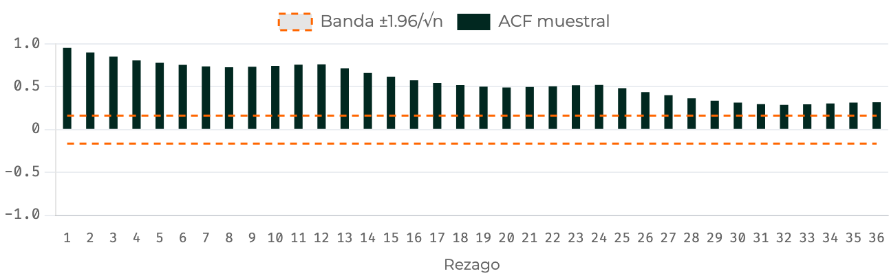
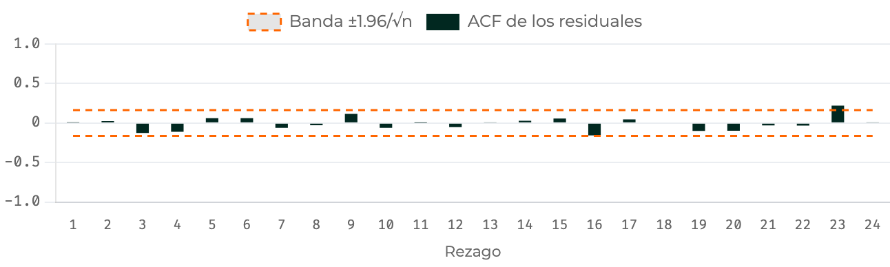
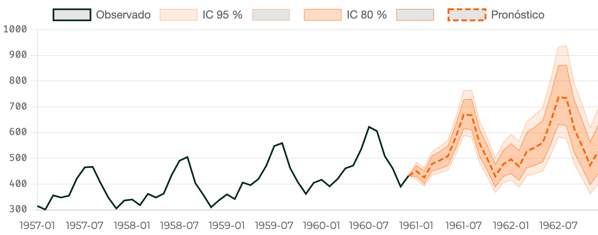
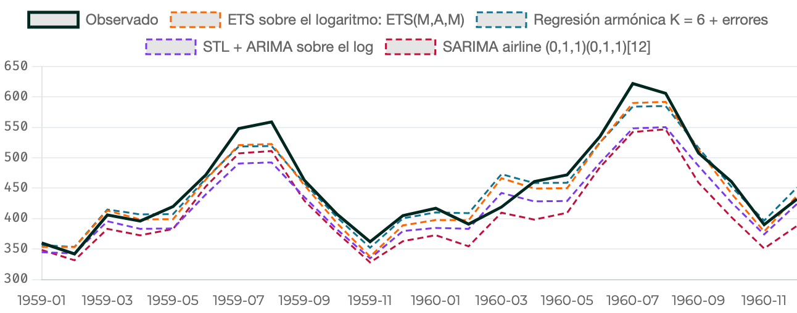

<!--
  Capítulo 5 · Modelos SARIMA. Un solo deck para DOS clases (decisión del docente, 2026-10-27):
    clase 1 = módulos 1 a 5 (hasta el cierre «Lo que se llevan de la clase 1» y «Para la próxima clase»);
    clase 2 = módulos 6 a 11 (empieza en el divisor «Clase 2 · …»).
  A 2–3 min por diapositiva de materia, cada clase cubre unos 90–100 min.

  Convención (igual que el deck del capítulo 4, petición del docente):
    · cada afirmación lleva una etiqueta: Dato · Definición · Interpretación · Opinión
    · cada cifra lleva su fuente en la línea pequeña:
        J = precalculo/salidas/cap5_sarima.json   J4 = cap4_arima.json   J3 = cap3_arma.json
        R = recálculo en R 4.6.0 sobre los datos (verificacion/directo_cap5.json)
        PY = statsmodels 0.14.6 (verificacion/directo_python_cap5.json)
        C = texto del capítulo   D = documentación de R
    · lo que no se pudo contrastar va marcado [SIN VERIFICAR]
  Las cifras se contrastan con verificacion/verifica_cifras_cap5.py (escribe verificacion_cifras_cap5.md).
  Los tres gráficos animados salen de verificacion/genera_animados_cap5.py, que los construye desde J.
-->

## Cada afirmación es un dato, una definición, una interpretación o una opinión

Cada afirmación lleva su etiqueta y cada cifra, su fuente: así se distingue lo que se midió de lo que se interpreta.

| Etiqueta | Qué es |
|---|---|
| <kbd>Dato</kbd> | Una cifra calculada sobre una serie concreta; lleva fuente y se contrastó en R |
| <kbd>Definición</kbd> | Una verdad matemática o una convención: no depende de la serie |
| <kbd>Interpretación</kbd> | La lectura que el capítulo hace de los datos: se puede discutir |
| <kbd>Opinión</kbd> | Una recomendación o regla práctica: se defiende, no se demuestra |

<mark>[SIN VERIFICAR]</mark> marca lo que no se pudo contrastar con una fuente: no es un dato confirmado.

<small>Fuentes: **J** = `cap5_sarima.json` · **J4** = `cap4_arima.json` · **J3** = `cap3_arma.json` · **R** = recálculo en R 4.6 · **PY** = statsmodels · **C** = capítulo · **D** = documentación de R</small>

???
La misma regla de juego del capítulo 4: cada cifra lleva su fuente en la línea pequeña de abajo, y cada afirmación su etiqueta. Lo resaltado «SIN VERIFICAR» no se cita como dato.

Lo que no se pudo contrastar en esta presentación <mark>[SIN VERIFICAR]</mark>: el origen de la TRM en datos.gov.co (solo se comprobó contra la copia congelada del repositorio); quién acuñó el nombre *airline* y si es «el SARIMA más usado»; la tabla de métodos modernos del Módulo 11 (el capítulo la resume de las competencias M4 y M5 sin citar resultados concretos); y los capítulos de Shumway y Stoffer y de Box, Jenkins, Reinsel y Ljung en las lecturas. Las secciones de FPP3 sí se comprobaron en su edición en línea.

Verificación: las cifras salen de `precalculo/salidas/cap5_sarima.json` y se recalcularon desde los datos en R 4.6.0 con forecast 9.0.2 (`verificacion/verifica_directo_cap5.R`), lo que el JSON no guarda incluido: la tabla de varianzas con parte AR, el horizonte de 24 meses y los crecimientos anuales del Módulo 11. Las cifras de Python, con statsmodels 0.14.6. El detalle, cifra por cifra, está en `verificacion/verificacion_cifras_cap5.md`.

# Clase 1 · Módulo 1 · La firma de la estacionalidad {seccion=modulo-1}

> El capítulo 4 terminó con un fracaso deliberado: toda la estructura que el mejor ARIMA no estacional no capturaba estaba en un solo sitio.

???
Gancho: recordar la última diapositiva del capítulo 4. Preguntar qué tenían en común las dos barras que sobraban (rezagos 12 y 24). Hoy se escribe un modelo que pone parámetros justo ahí.

## El capítulo 4 dejó toda la estructura sobrante en los múltiplos de 12

- <kbd>Dato</kbd> El mejor ARIMA no estacional, un ARIMA(0,1,5), deja en sus residuales \(\hat\rho_{12}=0.7245\) y \(\hat\rho_{24}=0.6727\), con banda \(\pm0.163\); Ljung–Box(24): \(Q=222.4\)
- <kbd>Dato</kbd> El *airline* (SARIMA(0,1,1)(0,1,1)\(_{12}\), Módulo 5), con **dos** parámetros, deja \(\hat\rho_{12}=-0.0515\) y pasa Ljung–Box(24) con \(p=0.233\)
- <kbd>Interpretación</kbd> Cinco términos MA no bastan porque lo que falta no está en los primeros rezagos: está en 12, 24, 36

<small>Contexto: `AirPassengers` en logaritmos, mensual, 1949–1960 (\(n=144\)). Fuente: J4 `puente_estacional` · J `airline.diagnostico` · R</small>

???
Es el puente explícito con el capítulo 4. El ARIMA(0,1,5) es el mejor con p + q ≤ 5 (el tope por defecto de auto.arima). No comparar su AICc con el del *airline*: el no estacional se evalúa sobre 143 observaciones y el airline sobre 131 (eso vuelve en el Módulo 6). Lo que decide es el diagnóstico.

Verificación: ρ̂₁₂, ρ̂₂₄, banda y Q del ARIMA(0,1,5) en J4 (`puente_estacional.no_estacional`); ρ̂₁₂ y p del airline en J y en R. Detalle: Módulo 1, apertura.

## Cuatro series conducen el capítulo, y la cuarta es un contraejemplo

| Serie | De dónde sale | Qué ilustra |
|---|---|---|
| **log(AirPassengers)** · pasajeros aéreos, 1949–1960 (*n* = 144) | `AirPassengers` de R; Box, Jenkins y Reinsel (1994) | El ciclo completo |
| **USAccDeaths** · muertes accidentales en EE. UU., 1973–1978 (*n* = 72) | `USAccDeaths` de R; Brockwell y Davis (1991) | Pruebas que engañan |
| **co2** · CO₂ en Mauna Loa, 1959–1997 (*n* = 468) | `co2` de R; Keeling y Whorf (Scripps) | Los ejercicios |
| **TRM** · COP/USD, ene. 2015–jun. 2026 (*n* = 138) | Superintendencia Financiera (SFC), vía datos.gov.co <mark>[SIN VERIFICAR]</mark> | Mensual **sin** estación |

<small>Todas mensuales. «Qué ilustra» es <kbd>Interpretación</kbd> del capítulo. TRM: copia congelada, no cotejada con datos.gov.co. Fuente: R · D `?AirPassengers`, `?USAccDeaths`, `?co2`</small>

???
Presentar las cuatro series una vez y no volver a explicarlas: cada diapositiva de ejemplo repite en una línea de cuál habla. La TRM ya se conoce del capítulo 4; aquí cumple el papel contrario: mostrar que una serie mensual no tiene por qué ser estacional.

Verificación: AirPassengers, USAccDeaths y co2 congelados en `datos_series.json` son idénticos a los de `datasets` de R (R); fechas, n y fuentes según la ayuda de R 4.6 (D). Origen de la TRM <mark>[SIN VERIFICAR]</mark>: solo se comprobó la copia congelada (n = 138, de 2015-01 a 2026-06).

## La estacionalidad tiene un periodo fijado por el calendario; el ciclo, no

::: definicion Estacionalidad de periodo \(m\)
El patrón se repite cada \(m\) observaciones y \(m\) lo fija el **calendario**: \(m=12\) mensual, \(4\) trimestral, \(7\) diario con patrón semanal, \(52\) semanal.
:::

- <kbd>Definición</kbd> El **ciclo** tiene duración variable y desconocida: los 11.22 años de las manchas solares del capítulo 3
- <kbd>Interpretación</kbd> Si \(m\) es conocido, se **impone** (diferenciar cada 12, un parámetro en el rezago 12); si no, hay que estimarlo, y eso es otro problema

<small>Fuente: C Módulo 1 · J3 `cap3_arma.json` (periodo de las manchas solares: 11.2178 años)</small>

???
Todo el capítulo depende de que m venga dado. Preguntar: ¿las manchas solares podrían modelarse con un SARIMA de m = 11? No: el periodo no es fijo ni entero.

Verificación: la definición y la distinción con el ciclo son del capítulo (Módulo 1). El periodo de 11.22 años sale del precálculo del capítulo 3 (11.2178). Detalle: Módulo 1, definición.

## Con datos mensuales la estacionalidad está en 12, 24 y 36, no en los primeros rezagos

{alto=300}

<kbd>Dato</kbd> Picos en \(\hat\rho_{12}=0.762\), \(\hat\rho_{24}=0.520\) y \(\hat\rho_{36}=0.319\), todas sobre la banda \(\pm0.163\). <kbd>Opinión</kbd> Pedir siempre **al menos \(3m\)** rezagos: con 20 o 24 se ve un pico y no se sabe si decae.

<small>Contexto: `AirPassengers` en logaritmos, \(n=144\). Fuente: J `firma.airpassengers_log` · R</small>

???
Señalar los picos, en naranja, sobre el decaimiento lento: el decaimiento es la tendencia; los picos, la estacionalidad. El simulador del Módulo 1 pone al lado el mapa mes × año: con logaritmo y las dos diferencias, las bandas verticales desaparecen y la ACF se queda con dos barras, en 1 y 12. Abrirlo en vivo desde el enlace del divisor si hay tiempo.

Verificación: ρ̂₁₂, ρ̂₂₄, ρ̂₃₆ y la banda en J (`firma.airpassengers_log`) y en R (`m1.ap_log`). ρ̂₂₄ se redondea desde el exacto, 0.52049, y no desde el 0.5205 de J: 0.520, como en el capítulo. Detalle: Módulo 1, «Dónde mirar la ACF».

## Cuatro filas se parecen y solo tres de esas series son estacionales

| Serie | \(\hat\rho_1\) | \(\hat\rho_{12}\) | \(\hat\rho_{24}\) | \(\hat\rho_{36}\) | Banda |
|---|---|---|---|---|---|
| log(AirPassengers) | 0.954 | 0.762 | 0.520 | 0.319 | 0.163 |
| USAccDeaths | 0.707 | 0.629 | 0.450 | 0.302 | 0.231 |
| co2 (Mauna Loa) | 0.991 | 0.928 | 0.855 | 0.783 | 0.091 |
| TRM en niveles | 0.964 | 0.636 | 0.490 | 0.225 | 0.167 |
| **∇TRM** | 0.088 | **−0.002** | −0.067 | 0.071 | 0.167 |

<kbd>Interpretación</kbd> Con tendencia, \(\hat\rho_k\) es grande en **todos** los rezagos, también en los múltiplos de 12. El diagnóstico se hace **después** de quitar la tendencia: solo la última fila dice algo.

<small>Fuente: J `firma` · R (ACF recalculada sobre los datos; bandas \(1.96/\sqrt n\))</small>

???
La trampa de la tabla: la TRM tiene ρ̂₁₂ = 0.636 y ninguna estacionalidad. Antes de pasar, preguntar cuál de las cuatro primeras filas es la intrusa; después de ver la quinta, la respuesta es obvia. El Módulo 8 vuelve sobre la TRM con cuatro evidencias.

Verificación: cada celda se recalculó desde los datos congelados con divisor n (como `Acf`), para no redondear dos veces: en cinco celdas los cuatro decimales de J acaban en 5, y los exactos (0.52049, 0.70747, 0.85546, 0.63649 y −0.00245) dan 0.520, 0.707, 0.855, 0.636 y −0.002, las mismas cifras de la tabla del capítulo. La banda de ∇TRM es 1.96/√137 = 0.16745 → 0.167 (J guarda 0.1675). Para ρ̂₁₂ de ∇TRM, el código del capítulo, que descarga la serie en vivo, imprime −0.0024, y la tabla del Módulo 8 dice −0.0025 (el capítulo explica el empate). Detalle: Módulo 1, tabla.

## ¿Es estacional una serie con \(\hat\rho_{12}=0.636\) en niveles? {.pregunta}

La TRM mensual, 138 meses. Banda \(\pm0.167\).

1. Sí, porque 0.636 supera con claridad la banda
2. Hace falta una diferencia estacional
3. La banda está mal calculada
4. Todavía no se puede decir

::: respuesta 4 · Todavía no se puede decir
En niveles la tendencia infla **todos** los \(\hat\rho_k\): \(\hat\rho_1=0.964\) y \(\hat\rho_{36}=0.225\) son decaimiento lento, no un pico. Sobre ∇TRM los tres múltiplos de 12 valen −0.002, −0.067 y 0.071, todos dentro de \(\pm0.167\).
:::

<small>Fuente: J `firma.trm`, `trm_contraejemplo` · R · C autoevaluación, pregunta 1</small>

???
Pregunta 1 de la autoevaluación del capítulo (Módulo 11). Pedir que voten antes de revelar. La opción 2 es la más tentadora; la 3 no: 1.96/√138 = 0.167 está bien calculada. J guarda 0.6365, un empate; el exacto es 0.63649, y aquí, como en el material, va 0.636.

Verificación: ρ̂₁, ρ̂₁₂, ρ̂₃₆ en niveles y los tres de ∇TRM en J y R; −0.002 sale del exacto, −0.00245 (J guarda −0.0025), con la misma precisión que la tabla anterior. Detalle: Módulo 1 y Módulo 8.

## Ver y medir la estacionalidad cabe en cinco líneas de R {columnas=3:2}

```r Ver y medir {resaltar=5-7}
library(forecast)
ap <- log(AirPassengers)        # m = 12, n = 144

ggseasonplot(ap, year.labels = TRUE)
a <- Acf(ap, lag.max = 36, plot = FALSE)
round(a$acf[c(2, 13, 25, 37)], 4)   # rezagos 1, 12, 24, 36
#> [1] 0.9537 0.7619 0.5205 0.3193
round(1.96 / sqrt(length(ap)), 4)  # banda
#> [1] 0.1633
```

|||

- `ggseasonplot()`: un trazo por año, los meses en el eje x
- `lag.max = 36`: **\(3m\)** rezagos
- `a$acf[1]` es el rezago 0: el 12 está en la posición 13

<small>Fuente: código del Módulo 1, ejecutado en R 4.6</small>

???
El bloque es el del material recortado: falta `monthplot()` y el contraejemplo de la TRM, que descarga la serie de datos.gov.co (necesita internet). En Python, `plot_acf()` dibuja por defecto muy pocos rezagos para una serie mensual: hay que pedir `lags=36`.

Verificación: el bloque se ejecutó en R 4.6.0 y sus dos salidas coinciden. Detalle: Módulo 1, bloque «Ver la estacionalidad».

# Módulo 2 · Notación SARIMA y polinomio multiplicativo {seccion=modulo-2}

> Si la estacionalidad hace que \(y_t\) se parezca a \(y_{t-12}\) como la dinámica ordinaria lo hace parecerse a \(y_{t-1}\), basta escribir el mismo modelo dos veces y multiplicarlos.

???
La idea del módulo en una frase: el mismo modelo en B y en B^m, multiplicados. Lo único genuinamente nuevo del capítulo es lo que sale de esa multiplicación.

## Un SARIMA escribe el mismo modelo en \(B\) y en \(B^m\), y multiplica las dos copias

::: definicion SARIMA(p,d,q)(P,D,Q)ₘ
$$\Phi_P(B^m)\,\phi_p(B)\,(1-B^m)^D(1-B)^d\,y_t = c + \Theta_Q(B^m)\,\theta_q(B)\,\varepsilon_t$$
:::

- <kbd>Definición</kbd> **Mayúsculas**, estacionales (polinomios en \(B^m\)); **minúsculas**, regulares
- <kbd>Definición</kbd> Estacionariedad, invertibilidad, criterios y diagnóstico: lo de los capítulos 3 y 4, sobre el polinomio **ya multiplicado**

<small>Fuente: C Módulo 2, definición</small>

???
Leer la ecuación de izquierda a derecha: AR estacional, AR regular, integración estacional, integración regular; a la derecha, MA estacional y MA regular. Convención de signos de R: θ(B) = 1 + θ₁B + … (la misma del capítulo 4).

Detalle: Módulo 2, definición.

## Multiplicar es preguntar dos veces: primero al mes anterior, después al año anterior {columnas=2:3}

| | Febrero | Marzo |
|---|---|---|
| 2024 | 15 | 20 |
| 2025 | 10 | ? |

<small>Ventas de una heladería **inventada**, en desvíos de su promedio</small>

|||

<kbd>Definición</kbd> SARIMA(1,0,0)(1,0,0)\(_{12}\) con \(\phi=0.6\) y \(\Phi=0.7\): \((1-0.6B)(1-0.7B^{12})\,y_t=\varepsilon_t\)

::: revelar
<kbd>Dato</kbd> **Regular**: lo que febrero no explica de marzo de 2024, \(20-0.6\cdot 15=11\)
:::

::: revelar
<kbd>Dato</kbd> **Estacional**: esa sorpresa se repite al año siguiente, \(0.7\cdot 11=7.7\)
:::

::: revelar
<kbd>Dato</kbd> **Pronóstico** de marzo de 2025: \(0.6\cdot 10+7.7=13.7\)
:::

<small>Contexto: cifras inventadas para seguir la cuenta a mano; \(\phi\) y \(\Phi\) son los del capítulo. Fuente: C Módulo 2, «Un ejemplo para seguir a mano»</small>

???
Tres pulsaciones, una por pregunta. Pedir la primera cuenta antes de revelarla. La «sorpresa» es lo que queda de un mes después de descontar el anterior; el factor estacional actúa sobre las sorpresas, no sobre las ventas. Eso es, en concreto, multiplicar los polinomios.

Verificación: 11, 7.7 y 13.7 se recalculan en el verificador con φ = 0.6 y Φ = 0.7, y son las cuentas del capítulo; su bloque de R las imprime. Detalle: Módulo 2, «Un ejemplo para seguir a mano».

## Multiplicar no es sumar: el rezago 13 aparece sin un parámetro propio

$$(1-\Phi B^{12})(1-\phi B) = 1-\phi B-\Phi B^{12}+\phi\Phi B^{13}$$

- <kbd>Definición</kbd> Un AR(13) con **dos** parámetros: de 2 a 11, cero; en el 13, \(+\phi\Phi\) en el polinomio (\(-\phi\Phi\) al despejar \(y_t\))
- <kbd>Dato</kbd> En la heladería: \(0.6\cdot 10+0.7\cdot 20-0.42\cdot 15=13.7\), como con las dos preguntas
- <kbd>Interpretación</kbd> El satélite, \(-0.42\cdot 15\), quita a marzo de 2024 lo que traía de febrero; **sumando** saldría 20

<small>Fuente: C Módulo 2, derivación</small>

???
Hacer la multiplicación en el tablero. Preguntar cuántos parámetros se estiman (dos) y cuántos coeficientes no nulos tiene el polinomio (tres: en 1, 12 y 13). Esa distancia entre parámetros libres y rezago más lejano es la economía de la notación. En la heladería, la diferencia entre sumar y multiplicar, 20 − 13.7 = 6.3, es justo 0.7 · 9: los 9 que marzo de 2024 traía de febrero.

Detalle: Módulo 2, «Multiplicar no es sumar».

## Con \(\phi=0.6\) y \(\Phi=0.7\) brotan satélites en 11 y 13 que nadie pidió

{alto=330}

::: revelar
<kbd>Definición</kbd> **Satélites**: barras en \(m\pm1\) que crea el producto. \(\rho_{11}=0.4230\) y \(\rho_{13}=0.4218\), cerca de \(\rho_1\rho_{12}=0.6016\times0.7011\).
:::

::: revelar
<kbd>Interpretación</kbd> Cada satélite es un **camino**: subir un año y retroceder un mes lleva al rezago 13.
:::

<small>Contexto: procesos teóricos, no una serie; \(\phi\) y \(\Phi\) son los del capítulo. Fuente: J `teoricas` · R</small>

???
Cinco pulsaciones: tres etapas del gráfico, la definición y el camino (un mes se parece al del año anterior, y este a su vecino). Primero el SAR(1) con Φ = 0.7: picos limpios en 12, 24 y 36 y cero en todo lo demás. Segundo, se multiplica por un AR(1) con φ = 0.6: la parte regular llena los rezagos bajos. Tercero, los satélites: barras en 11 y 13, simétricas alrededor del pico, que ningún parámetro pidió. Un correlograma con picos en 11, 12 y 13 no pide tres parámetros: pide dos.

Verificación: las barras salen de la ACF teórica de J (`teoricas.sar1_pos` y `teoricas.ar1_sar1`), y ρ₁₁ = 0.42298 y ρ₁₃ = 0.42180 se recalcularon con `ARMAacf` en R. Con parte AR el producto ρ₁ρ₁₂ = 0.42180 coincide con ρ₁₃ solo aproximadamente (lo precisa el Módulo 4). El gráfico lo genera `genera_animados_cap5.py` desde J. Detalle: Módulo 2, derivación (paso 4).

## La varianza se pide a la serie diferenciada, y solo se factoriza si el modelo es MA puro

::: warn Solo con \(d=D=0\)
Con diferencias no hay varianza finita: los momentos son de \(w_t=\nabla^d\nabla_m^D y_t\).
:::

$$\gamma_0=\operatorname{Var}(w_t)=\sigma^2\sum_{j\ge0}\psi_j^2$$

- <kbd>Dato</kbd> MA puro con \(q<m\), el *airline*: \(\gamma_0=\sigma^2(1+\theta^2)(1+\Theta^2)=1.5217\,\sigma^2\), 0.002087 frente a 0.002102 muestral
- <kbd>Dato</kbd> Con parte AR, \(\psi_{12}=\phi^{12}+\Phi\): con \(\phi=0.9\) y \(\Phi=0.7\), 15.406 exacta frente a 10.320 (−33.0 %)
- <kbd>Opinión</kbd> Con parte AR la varianza se **calcula**, no se multiplica

<small>Contexto: *airline* sobre `AirPassengers` en logaritmos; AR(1)×SAR(1) teórico. Fuente: J `airline` · R `m2` · C Módulo 2</small>

???
Por qué solo con w_t: un modelo con diferencias no tiene varianza finita. La media, μ = c/(φ_p(1)Φ_P(1)), se factoriza porque evaluar un producto de polinomios en B = 1 es multiplicar sus valores. La suma de los ψ² es la del intervalo de pronóstico del capítulo 4, llevada al infinito.

El regalo: en un MA puro con q < m los pesos caen en rezagos distintos y nunca chocan; en el airline, en 0, 1, 12 y 13. Con σ̂² = 0.001371 sale 0.002087, frente a 0.002102 en las 131 observaciones de ∇∇₁₂ log y, y en ρ₁ = θ/(1 + θ²) el factor estacional se cancela. Si q alcanza a m, los pesos chocan: con θ₁₂ = 0.5 y Θ = 0.6, 2.300σ² frente a 1.700σ².

El peaje: con parte AR el rezago 12 recibe dos caminos, doce pasos regulares o uno estacional. Con Φ = 0.7, el error de factorizar es −0.3 % con φ = 0.6, −9.2 % con 0.8, −33.0 % con 0.9 y −54.9 % con 0.95.

Verificación: 1.5217, 0.002087 (con σ̂² sin redondear: 0.00137126), 0.002102, 131, 2.300 y 1.700, recalculados en R (`m2`); la tabla de φ, en R (`m2.tabla_phi`, con 20 000 pesos ψ). Detalle: Módulo 2, «Media, varianza y autocorrelación».

## En un SARIMA(1,0,0)(1,0,0)\(_{12}\), ¿cuáles son ciertas? {.pregunta}

1. Toca el rezago 13 sin un parámetro propio en ese rezago
2. Tiene 2 parámetros libres
3. Su ACF teórica es cero en los rezagos 2 a 11
4. Escrito como AR no estacional, es un AR(13)

::: respuesta 1, 2 y 4
La 3 es falsa: la parte AR regular llena los rezagos bajos (con \(\phi=0.6\) y \(\Phi=0.7\), \(\rho_2=0.364\)). Los intermedios valen cero solo si \(\phi=0\).
:::

<small>Fuente: C autoevaluación, pregunta 2 · J `teoricas.ar1_sar1`</small>

???
Pregunta 2 de la autoevaluación, de selección múltiple. Pista si se atascan: expandir (1 − φB)(1 − ΦB¹²) y contar coeficientes no nulos y coeficientes estimados.

Verificación: la explicación del material dice «ρ₂ = ρ₁² ≈ 0.36»; en el proceso multiplicado ρ₂ = 0.3637 (J), que no es exactamente ρ₁² = 0.3619, aunque los dos redondean a 0.36. La diapositiva da el valor de J. Detalle: Módulo 2.

## En R el periodo va en `seasonal`, y el coeficiente de \(B^{13}\) sale del producto {columnas=3:2}

```r Escribir un SARIMA {resaltar=8-10}
library(forecast)
ap  <- log(AirPassengers)
fit <- Arima(ap, order = c(0, 1, 1),
             seasonal = list(order = c(0, 1, 1), period = 12))
round(coef(fit), 4)
#>     ma1    sma1
#> -0.4018 -0.5569
th <- coef(fit)[["ma1"]]; Th <- coef(fit)[["sma1"]]
round(c(B1 = th, B12 = Th, B13 = th * Th), 4)
#>      B1     B12     B13
#> -0.4018 -0.5569  0.2238
```

|||

- <kbd>Dato</kbd> El coeficiente de \(B^{13}\), **0.2238**, no se estima: es \(\theta\Theta\)
- <kbd>Interpretación</kbd> El choque de hace 13 meses llega por **dos caminos**, un año y un mes: por eso pesa \(\theta\Theta\)
- <kbd>Definición</kbd> La forma no multiplicativa necesita **13** parámetros para tocar los mismos rezagos
- Este SARIMA(0,1,1)(0,1,1)\(_{12}\) es el *airline* del Módulo 5

<small>Fuente: código del Módulo 2, ejecutado en R 4.6 · J `airline.coeficientes`</small>

???
En Python: `SARIMAX(..., seasonal_order=(0, 1, 1, 12), trend="n", simple_differencing=True)` reproduce los mismos coeficientes; la opción `simple_differencing` vuelve en el Módulo 6, porque cambia el n efectivo.

Verificación: el bloque se ejecutó en R 4.6.0 y sus salidas coinciden con las de J. Detalle: Módulo 2, «Cómo se escribe en la práctica».

# Módulo 3 · Diferenciación estacional: cuántas y en qué orden {seccion=modulo-3}

> La diferencia estacional se aplica en un orden que da igual; se decide en un orden que no.

???
Aquí se deciden D y d; P y Q, en el Módulo 4.

## \(\nabla_{12}\) compara enero con enero, cuesta doce observaciones y contiene a \(\nabla\)

::: definicion Diferencia estacional
$$\nabla_m y_t=(1-B^m)\,y_t=y_t-y_{t-m}$$
:::

$$1-B^{12}=(1-B)(1+B+B^2+\cdots+B^{11})$$

- <kbd>Definición</kbd> \(\nabla_{12}\) quita la tendencia lineal **y** el patrón estacional; por eso a veces basta \(D=1\), \(d=0\)
- <kbd>Definición</kbd> \(\nabla^{12}\) es otra cosa: doce restas seguidas contra el mes anterior, no una contra el año anterior

<small>Fuente: C Módulo 3, definición y derivación</small>

???
Para quien quiera la versión algebraica: ∇^12 tiene una raíz de multiplicidad doce en B = 1, y ∇₁₂ doce raíces distintas sobre el círculo unitario, las raíces duodécimas de la unidad; solo una vale B = 1. Las otras once están en las frecuencias estacionales: son las que anulan el patrón que se repite cada doce meses. Aplicar además ∇ vuelve a imponer B = 1, que ya estaba: se hace cuando la tendencia es más que lineal, no por rutina.

Detalle: Módulo 3, derivación.

## \(\nabla_{12}\) resta la celda de arriba y \(\nabla\), la de la izquierda

| | Ene | Feb | Mar | Abr | May | Jun | Jul | Ago | Sep | Oct | Nov | Dic |
|---|---|---|---|---|---|---|---|---|---|---|---|---|
| 2022 | 94 | 93 | 98 | 101 | 104 | 109 | 112 | 111 | 108 | 107 | 112 | 117 |
| 2023 | 106 | 105 | 110 | 113 | 116 | 121 | 124 | 123 | 120 | 119 | 124 | 129 |
| 2024 | 118 | 117 | 122 | 125 | 128 | 133 | 136 | 135 | 132 | 131 | 136 | 141 |
| 2025 | 130 | 129 | 134 | 137 | 140 | 145 | 148 | 147 | 144 | 143 | 148 | 153 |

<kbd>Definición</kbd> Tienda **inventada**: 100 unidades al abrir, una más cada mes y un patrón anual de suma cero. Marzo de 2024 menos marzo de 2023: \(122-110=12\).

<small>Contexto: cifras construidas para seguirlas a mano, enero de 2022 a diciembre de 2025. Fuente: C Módulo 3, «Un ejemplo para seguir a mano» (su bloque de R imprime esta cuadrícula)</small>

???
Es la misma vista del mapa mes × año del Módulo 1: un año por fila. Con ella, las dos diferencias son dos direcciones de resta: hacia arriba, el mismo mes del año anterior; hacia la izquierda, el mes anterior (a enero le toca el diciembre de la fila de arriba). Pedir que calculen una celda de cada antes de pasar.

Verificación: la cuadrícula se recalcula en el verificador con la fórmula de la tienda y coincide fila a fila con la que imprime el bloque de R del capítulo. Detalle: Módulo 3, «Un ejemplo para seguir a mano», y su simulador «La tienda inventada, celda a celda».

## \(\nabla\) deja el patrón; \(\nabla_{12}\) quita patrón y tendencia; las dos, todo

| | Ene | Feb | Mar | Abr | May | Jun | Jul | Ago | Sep | Oct | Nov | Dic |
|---|---|---|---|---|---|---|---|---|---|---|---|---|
| \(\nabla\) · 2024 | −11 | −1 | 5 | 3 | 3 | 5 | 3 | −1 | −3 | −1 | 5 | 5 |
| \(\nabla\) · 2025 | −11 | −1 | 5 | 3 | 3 | 5 | 3 | −1 | −3 | −1 | 5 | 5 |
| \(\nabla_{12}\) · 2024 | 12 | 12 | 12 | 12 | 12 | 12 | 12 | 12 | 12 | 12 | 12 | 12 |
| \(\nabla\nabla_{12}\) · 2024 | 0 | 0 | 0 | 0 | 0 | 0 | 0 | 0 | 0 | 0 | 0 | 0 |

::: revelar
<kbd>Dato</kbd> \(\nabla\): cada año repite los mismos doce números; el patrón sigue ahí, escrito como cambios
:::

::: revelar
<kbd>Dato</kbd> \(\nabla_{12}\): 12 en todas las celdas, lo que la tienda gana en un año; la tendencia lineal se volvió una constante
:::

::: revelar
<kbd>Dato</kbd> \(\nabla\nabla_{12}\): ceros; con crecimiento fijo ya no quedaba nada que quitar
:::

<small>Contexto: la tienda inventada de la diapositiva anterior. Fuente: C Módulo 3 (bloque de R y simulador)</small>

???
Tres pulsaciones, una por operador. La primera es la que más cuesta: ∇ quita la tendencia, pero el patrón sigue ahí, porque los cambios de un mes al siguiente se repiten cada año. Por eso, con datos reales, la diferencia regular sube ρ̂₁₂ en vez de bajarlo. La segunda muestra que ∇₁₂ contiene a ∇: la tendencia lineal queda como una constante.

Verificación: las filas se recalculan en el verificador y coinciden con las del bloque de R del capítulo. Detalle: Módulo 3, «Un ejemplo para seguir a mano».

## Si la tienda acelera en 2024, \(\nabla_{12}\) deja una rampa y hace falta \(\nabla\)

| | Ene | Feb | Mar | Abr | May | Jun | Jul | Ago | Sep | Oct | Nov | Dic |
|---|---|---|---|---|---|---|---|---|---|---|---|---|
| \(\nabla_{12}\) · 2023 | 12 | 12 | 12 | 12 | 12 | 12 | 12 | 12 | 12 | 12 | 12 | 12 |
| \(\nabla_{12}\) · 2024 | 14 | 16 | 18 | 20 | 22 | 24 | 26 | 28 | 30 | 32 | 34 | 36 |
| \(\nabla\nabla_{12}\) · 2024 | 2 | 2 | 2 | 2 | 2 | 2 | 2 | 2 | 2 | 2 | 2 | 2 |

- <kbd>Dato</kbd> Desde 2024 gana tres unidades al mes: \(\nabla_{12}\) sube de 12 a 36 y \(\nabla\) lo recoge
- <kbd>Dato</kbd> En \(\log(\text{AirPassengers})\), la media anual de \(\nabla_{12}\) va de 0.032 (1958) a 0.201 (1951): por eso deja \(\hat\rho_1=0.714\)

<small>Fuente: C Módulo 3 · CALC sobre los datos congelados</small>

???
Es la frontera de la decisión: con crecimiento fijo, D = 1 y d = 0 bastan; si el crecimiento cambia, hace falta d = 1. La diapositiva siguiente lo enseña con datos reales: la fila de ∇₁₂ sola deja ρ̂₁ = 0.714, que es esta rampa en una serie de verdad.

Verificación: las filas de la tienda se recalculan en el verificador y coinciden con las del capítulo; las medias anuales de ∇₁₂ log y (0.032 y 0.201), recalculadas sobre los datos congelados; 0.714 es J. Detalle: Módulo 3, «Un ejemplo para seguir a mano».

## Cada operador hace su trabajo y solo el suyo

{alto=410}

::: revelar
<kbd>Dato</kbd> ∇ sola hace **subir** \(\hat\rho_{12}\) de 0.762 a 0.841; \(\nabla_{12}\) sola deja \(\hat\rho_1=0.714\). Las dos: varianza mínima, 0.002102.
:::

<small>Contexto: `AirPassengers` en logaritmos; \(n\) = 144, 143, 132 y 131. Fuente: J `combinaciones` · R</small>

???
Cinco pulsaciones: una combinación por paso y, al final, la conclusión. En el primero, la serie sin diferenciar: todo grande. En el segundo, ∇: la tendencia se va (ρ̂₁ cae a 0.20), pero la estacionalidad se concentra (ρ̂₁₂ sube). En el tercero, ∇₁₂: la estación se va y queda la tendencia (ρ̂₁ = 0.71). En el cuarto, las dos: dos barras negativas, la firma de dos MA, y la varianza mínima. La regla de la varianza del capítulo 4 acierta aquí.

Verificación: ρ̂₁, ρ̂₁₂ y la varianza de cada combinación en J (`combinaciones`) y recalculados en R; el gráfico lo genera `genera_animados_cap5.py` desde J. El capítulo dice que ∇ reduce la varianza «a la vigésima parte» y ∇₁₂ «cincuenta veces»: los cocientes exactos son 17.2 y 51.3. Detalle: Módulo 3, «Las cuatro combinaciones».

## `ndiffs()` da 0 en la serie cruda y 1 tras \(\nabla_{12}\): ¿qué significa? {.pregunta}

La serie es **USAccDeaths**, mensual (\(n=72\)).

1. Que `ndiffs()` tiene un error
2. Que la serie está sobrediferenciada tras \(\nabla_{12}\)
3. Que la estacionalidad tapa la tendencia: \(D\) se decide antes que \(d\)
4. Que hay que aplicar \(\nabla\) dos veces, una por resultado

::: respuesta 3
Son dos entradas distintas: \(y_t\) y \(\nabla_{12}y_t\). Sobre la serie cruda, la varianza estacional impide ver la raíz unitaria regular. En Python pasa igual: KPSS da 0.8672 sobre \(\nabla_{12}y_t\) (crítico al 5 %: 0.463) y 0.0713 sobre \(\nabla\nabla_{12}y_t\).
:::

<small>Contexto: `USAccDeaths`, mensual, 1973–1978 (\(n=72\)). Fuente: J `orden_pruebas` · PY · C autoevaluación, pregunta 4</small>

???
Pregunta 4 de la autoevaluación. La opción 2 es la trampa: la firma de sobrediferenciar sería θ̂ próximo a −1, y el modelo final da θ̂ = −0.4303.

Verificación: ndiffs 0 y 1 en J y en R; KPSS 0.8672, 0.0713 y el crítico 0.463 con statsmodels 0.14.6 (PY). Detalle: Módulo 3, «El orden en que se decide».

## Los operadores conmutan: \(\nabla\nabla_{12}y_t\) es la misma serie en cualquier orden {columnas=3:2}

```r USAccDeaths: el orden de las decisiones {resaltar=4,6}
library(forecast)
uad <- USAccDeaths
c(ndiffs_crudo = ndiffs(uad), nsdiffs = nsdiffs(uad))
#> ndiffs_crudo      nsdiffs
#>            0            1
ndiffs(diff(uad, lag = 12))    # d, DESPUÉS de quitar la estación
#> [1] 1
max(abs(diff(diff(uad, lag = 12)) - diff(diff(uad), lag = 12)))
#> [1] 0
```

|||

- <kbd>Dato</kbd> Diferencia máxima entre los dos órdenes: **0**
- <kbd>Dato</kbd> Lo que cambia es la **prueba**: 0 sobre la serie cruda, 1 sobre \(\nabla_{12}y_t\)
- <kbd>Definición</kbd> `nsdiffs()` estima \(D\) como `ndiffs()` estima \(d\)
- <kbd>Definición</kbd> Las dos juntas son \(y_t-y_{t-1}-y_{t-12}+y_{t-13}\): las cuatro esquinas de un cuadrado de la cuadrícula; en la tienda que acelera, \(128-121-110+105=2\)

<small>Fuente: código del Módulo 3, ejecutado en R 4.6 · J `orden_pruebas`</small>

???
La lección se enuncia en la diapositiva siguiente. Aquí, que lo vean: misma serie, distinta decisión según el orden en que se pregunta. Hilo con el Módulo 2: el cuadrado es el de la heladería con φ = Φ = 1, porque (1 − B)(1 − B¹²) es el modelo multiplicativo con los dos coeficientes en 1.

Verificación: el bloque se ejecutó en R 4.6.0 y sus tres salidas coinciden con J (`orden_pruebas.usaccdeaths`, `orden_pruebas.conmutan`). Detalle: Módulo 3, bloque «Elegir D y d».

## Primero \(D\), después \(d\) {.idea etiqueta="Opinión"}

Los operadores conmutan; las pruebas que los eligen, no. La estacionalidad domina la varianza y esconde la tendencia.

???
Es la regla práctica del módulo: se defiende con el caso USAccDeaths, no se demuestra. Recordar que el ejercicio 2 del capítulo la pone a prueba resolviendo la serie por los dos caminos.

## Diferenciar de más deja la firma del capítulo 4: \(\hat\Theta\) se acerca a −1

| \(D\) | \(n\) | Varianza | \(\hat\Theta\) | e. e. |
|---|---|---|---|---|
| 0 | 143 | 0.011354 | +0.7397 | 0.0610 |
| 1 | 131 | **0.002102** | −0.5569 | 0.0731 |
| 2 | 119 | 0.005960 | **−0.9973** | 0.0830 |

<kbd>Dato</kbd> Con \(D=2\) la varianza vuelve a subir **y** \(\hat\Theta=-0.9973\): la raíz MA cae sobre el círculo. <kbd>Interpretación</kbd> La segunda alarma es la fiable: la regla de la varianza falla en casos reales.

<small>Contexto: SARIMA(0,1,1)(0,\(D\),1)\(_{12}\) sobre `AirPassengers` en logaritmos. Fuente: J `sobrediferenciacion_estacional` · R</small>

???
Recordar el caso del capítulo 4: en log(lynx), diferenciar de más reducía la varianza un 58 %. Por eso la raíz es la evidencia que manda.

La tabla del capítulo trae además el módulo inverso de las raíces MA (0.9752, 0.9524 y 0.9998). No se proyecta porque con un SMA(1) ese módulo es \(|\Theta|^{1/12}\), que se acerca a 1 con casi cualquier Θ: la alarma se lee en \(\hat\Theta\).

Verificación: cada fila en J (`sobrediferenciacion_estacional`); el 58 % de lynx es del capítulo 4 (C). Detalle: Módulo 3, simulador «¿Y si diferencio de más?».

## `nsdiffs()` cambió de prueba por defecto: `seas` y `ocsb` no dan lo mismo

| Serie | `ndiffs` crudo | `ndiffs` tras \(\nabla_{12}\) | `nsdiffs` (`seas`) | `nsdiffs` (`ocsb`) |
|---|---|---|---|---|
| log(AirPassengers) | 1 | 1 | 1 | **0** |
| USAccDeaths | **0** | **1** | 1 | **0** |
| co2 | 1 | 1 | 1 | 1 |
| TRM | 1 | 1 | 0 | 0 |

<kbd>Dato</kbd> La prueba por defecto es hoy `seas` (fuerza estacional, de la descomposición STL) y antes era `ocsb` (Osborn–Chui–Smith–Birchenhall); el cambio entró en forecast 8.3. <kbd>Opinión</kbd> Al comparar dos salidas, conviene mirar primero **qué prueba** usa cada una; si discrepan, manda el correlograma.

<small>Fuente: J `orden_pruebas` · R · D `?nsdiffs`, `NEWS.md` de forecast (8.3) y `formals(nsdiffs)`</small>

???
Con la prueba antigua (OCSB) se habría respondido D = 0 en AirPassengers y en USAccDeaths, aunque las dos son claramente estacionales. Es la misma trampa que la de `ndiffs()` y `kpss.test()` del capítulo 2.

Verificación: la tabla en J (`orden_pruebas`) y en R. El NEWS de forecast 9.0.2 registra en la versión 8.3 «Changed method for choosing D in auto.arima() to a measure of seasonal strength», y `formals(nsdiffs)$test` empieza por `"seas"` (D). El capítulo dice «desde forecast 8.x»: coherente. Detalle: Módulo 3, advertencia «Trampa de versión», y tabla del Módulo 8.

# Módulo 4 · Identificar los órdenes estacionales {seccion=modulo-4}

> La buena noticia de la notación multiplicativa es que no hay teoría nueva que aprender.

???
Con D y d decididos, falta leer P y Q en los rezagos m, 2m y 3m, y no confundir un satélite con un parámetro que falta. La frase del divisor es la del capítulo.

## Los rezagos estacionales se leen con la misma tabla del capítulo 3

| | ACF en \(m, 2m, 3m\) | PACF en \(m, 2m, 3m\) |
|---|---|---|
| **SAR(\(P\))** | Decae | Se corta tras \(Pm\) |
| **SMA(\(Q\))** | Se corta tras \(Qm\) | Decae |
| **SARMA(\(P,Q\))** | Decae | Decae |

<kbd>Definición</kbd> SAR(1), \(\Phi=0.7\): 0.700, 0.490 y 0.343 en 12, 24 y 36. SMA(1), \(\Theta=-0.6\): −0.4412 en 12 y **exactamente 0** desde 24. En los dos, \(\rho_1=\cdots=\rho_{11}=0\).

<small>Fuente: C Módulo 4 · J `teoricas.sar1_pos`, `teoricas.sma1` · R</small>

???
No hay teoría nueva: la tabla del capítulo 3 aplicada a {m, 2m, 3m} en vez de a {1, 2, 3}. Los rezagos intermedios en cero también son información: si en una serie real hay barras grandes abajo **y** en los múltiplos de 12, hacen falta las dos partes, y ese es el caso normal.

Verificación: los valores teóricos en J y recalculados con `ARMAacf` en R. Detalle: Módulo 4, tabla de identificación.

## Los satélites no piden parámetros {.idea etiqueta="Interpretación"}

Barras simétricas en \(m\pm1\), de tamaño parecido a \(\rho_1\rho_{m}\), las produce la multiplicación de polinomios. Contarlas como parámetros es el error de conteo más frecuente.

???
Es la idea que hay que llevarse del Módulo 4. Antes de añadir un parámetro por una barra en 11 o 13, comprobar si es el producto de las de 1 y 12.

## En el *airline*, el producto es exacto; con parte AR solo se parece

| Proceso teórico | \(\rho_1\) | \(\rho_{11}\) | \(\rho_{12}\) | \(\rho_{13}\) | \(\rho_{24}\) |
|---|---|---|---|---|---|
| AR(1)×SAR(1), \(\phi=0.6\), \(\Phi=0.7\) | 0.602 | **0.423** | 0.701 | **0.422** | 0.491 |
| *Airline*, \(\theta=-0.4018\), \(\Theta=-0.5569\) | −0.346 | **0.147** | −0.425 | **0.147** | 0 |
| AR(1)×SMA(1), \(\phi=0.5\), \(\Theta=-0.7\) | 0.500 | **−0.234** | −0.470 | **−0.235** | ≈ 0 |

<kbd>Definición</kbd> Solo MA: \(\rho_{11}=\rho_{13}=\rho_1\rho_{12}\) **exactamente**. Con parte AR, 0.42298 y 0.42180 difieren en la tercera cifra. <kbd>Interpretación</kbd> Para identificar da igual; para calcular la varianza, no.

<small>Procesos teóricos; el *airline*, con lo estimado sobre AirPassengers. Fuente: J `teoricas` · R `m4`</small>

???
Un MA con q < m tiene un número finito de pesos que nunca se pisan; un AR los tiene infinitos y sí se pisan. Sobre un correlograma estimado, con su banda de ±1.96/√n, la diferencia entre 0.42298 y 0.42180 es invisible.

Verificación: la tabla en J (`teoricas`) y recalculada en R con `ARMAacf`. En el AR(1)×SMA(1), ρ₁₁ y ρ₁₃ no son iguales: −0.23446 y −0.23483, que redondean a −0.234 y −0.235, como en el capítulo. Con los coeficientes sin redondear, ρ₁₁ = ρ₁₃ = 0.14707 en el airline; el capítulo escribe 0.14705, que es el valor con −0.4018 y −0.5569 redondeados. A cuatro decimales los dos son 0.1471. Detalle: Módulo 4, «Los satélites».

## Picos de 0.80, 0.64 y 0.51 en 12, 24 y 36, y cero en lo demás: ¿qué modelo es? {.pregunta}

ACF teórica de un proceso estacional puro, \(m=12\).

1. Un SMA(1)\(_{12}\)
2. Un *airline*
3. Un SAR(1)\(_{12}\) con \(\Phi>0\)
4. Un AR(1)×SAR(1)

::: respuesta 3 · SAR(1) con \(\Phi=0.8\)
Los picos son \(\Phi\), \(\Phi^2\) y \(\Phi^3\) (0.8, 0.64 y 0.512): decaen, no se cortan (no es un SMA). Y en 1, 11 y 13 valen cero: no hay parte regular ni satélites (no es el *airline* ni el AR(1)×SAR(1)).
:::

<small>Fuente: C autoevaluación, pregunta 5 (con \(\Phi=0.8\) en lugar de 0.7) · definición del SAR(1)</small>

???
Es la pregunta 5 de la autoevaluación; en el material va con un gráfico y Φ = 0.7, aquí con los números y Φ = 0.8, para que no se responda copiando los del Módulo 2 ni los de la tabla de identificación. La PACF de este proceso se cortaría tras el rezago 12.

Verificación: 0.80, 0.64 y 0.51 son 0.8, 0.8² y 0.8³ = 0.512 redondeados (definición: en un SAR(1), ρ en 12k vale Φᵏ). Detalle: Módulo 4.

## El protocolo tiene cinco etapas, y cada fallo devuelve a la que lo causó

::: flujo
1. **Transformar** — ¿la amplitud crece con el nivel? Logaritmo o Box–Cox
2. **Elegir \(D\)** — `nsdiffs()` y la ACF en \(m, 2m, 3m\)
3. **Elegir \(d\)** — sobre la serie **ya** sin estación
4. **Identificar** — \((p,q)\) abajo, \((P,Q)\) en \(m\); los satélites no cuentan
5. **Estimar y diagnosticar** — Ljung–Box con \(2m\) rezagos y raíces
:::

<kbd>Opinión</kbd> Varianza creciente → etapa 1; raíz sobre el círculo → 2 o 3; barra en \(m\) → 4.

<small>Fuente: C Módulo 4, «El protocolo, paso a paso»</small>

???
Es el ciclo de Box–Jenkins del capítulo 4 con dos etapas insertadas (2 y 3). Lo que ninguna lista numerada dibuja son las vueltas atrás: el material las trae etapa por etapa en el componente del ciclo («Qué te devuelve atrás»). La etapa 3 depende de haber hecho bien la 2.

Detalle: Módulo 4, ciclo de etapas.

# Módulo 5 · El modelo airline {seccion=modulo-5}

> Dos diferencias y dos términos MA. El modelo aparece una y otra vez en series que no tienen nada que ver entre sí.

???
Último módulo de la clase 1. Cierra con la forma que la parte estacional le da a la incertidumbre del pronóstico.

## El *airline*: dos diferencias y dos MA para una serie con tendencia y estación

::: definicion El modelo airline: SARIMA(0,1,1)(0,1,1)₁₂
$$(1-B)(1-B^{12})\,y_t=(1+\theta B)(1+\Theta B^{12})\,\varepsilon_t$$
:::

- <kbd>Dato</kbd> La ayuda de R presenta `AirPassengers` como «the classic Box & Jenkins airline data» y ajusta este modelo en su ejemplo
- <kbd>Opinión</kbd> Es el punto de partida razonable de casi cualquier serie mensual; se dice que es «el SARIMA más usado del mundo» <mark>[SIN VERIFICAR]</mark>

<small>Fuente: C Módulo 5 · D `?AirPassengers`</small>

???
El capítulo dice que Box y Jenkins lo llamaron así porque lo ajustaron a log(AirPassengers) <mark>[SIN VERIFICAR]</mark>: el libro no está en el repositorio. Lo que sí se comprobó es que la ayuda de R llama a la serie «the classic Box & Jenkins airline data» y la acompaña del ejemplo «The classic 'airline model'» (con log10, no con el logaritmo natural).

Por qué funciona: ∇∇₁₂ deja estacionaria a casi cualquier serie mensual con tendencia y estación, y los dos MA absorben lo que queda con el mínimo de parámetros.

## Dos series sin nada en común eligen el mismo modelo y casi los mismos coeficientes

| Serie | \(n\) | `auto.arima` exhaustivo | \(\hat\theta\) | \(\hat\Theta\) |
|---|---|---|---|---|
| log(AirPassengers) | 144 | (0,1,1)(0,1,1)\(_{12}\) | −0.4018 | −0.5569 |
| USAccDeaths | 72 | (0,1,1)(0,1,1)\(_{12}\) | −0.4303 | −0.5528 |

<kbd>Dato</kbd> Distinta escala, distinta longitud, distinto fenómeno; USAccDeaths ni siquiera lleva logaritmo. <kbd>Interpretación</kbd> Ese es el argumento para conocer el *airline* de memoria.

<small>Contexto: pasajeros aéreos, 1949–1960; muertes accidentales en EE. UU., 1973–1978. Fuente: J `auto_arima`, `airline`, `usaccdeaths` · R</small>

???
La búsqueda exhaustiva (`stepwise = FALSE, approximation = FALSE`) llega al mismo modelo en las dos. USAccDeaths vuelve en la clase 2 con su diagnóstico completo.

Verificación: modelos y coeficientes en J (`airpassengers.auto_arima`, `airline.coeficientes`, `usaccdeaths.auto_arima`, `usaccdeaths.coeficientes`). Detalle: Módulo 5, tabla.

## Los pesos \(\psi\) suben en escalones: la incertidumbre salta al cruzar el rezago 12

{alto=380}

::: revelar
<kbd>Dato</kbd> \(\psi_j=1+\theta=0.5982\) para \(j=1,\dots,11\); \(\psi_{12}=1.0412\); \(\psi_j=0.8632\) de 13 a 23. \(\sigma_1=0.0370\), \(\sigma_{12}=0.0823\), \(\sigma_{24}=0.1396\) (escala log).
:::

<small>Contexto: el *airline* ajustado sobre `AirPassengers` en logaritmos. Fuente: J `pronostico.psi`, `pronostico.sigma_h`</small>

???
Cuatro pulsaciones: el primer año (pesos constantes, σ_h crece suavemente), el salto en el rezago 12, el segundo año en un nivel más alto y la conclusión. La lectura: el error de pronosticar el próximo julio se parece más al de pronosticar el julio siguiente que al del mes que viene. La construcción del intervalo desde los ψ es del capítulo 4; aquí solo se usa.

Verificación: ψ y σ_h en J (6 decimales). El capítulo da 1.0412 y 0.8632 en el texto, y su código del Módulo 7 imprime 1.0413 y 0.8633 porque usa los coeficientes redondeados. El gráfico lo genera `genera_animados_cap5.py` desde J. Detalle: Módulo 5, derivación.

## El *airline* acumula incertidumbre más despacio que una sola caminata aleatoria

- <kbd>Dato</kbd> \(\sigma_{12}/\sigma_1=2.22\), frente a \(\sqrt{12}=3.46\) en una caminata aleatoria
- <kbd>Interpretación</kbd> Pese a llevar **dos** raíces unitarias, los dos MA negativos amortiguan la integración
- <kbd>Definición</kbd> Con \(\Theta\to0\), el escalón del 12 desaparece; con \(\Theta\to-1\), los pesos se aplanan: el MA casi cancela la diferencia estacional

<small>Fuente: J `pronostico.sigma_h` · cálculo · C Módulo 5</small>

???
Es el mismo mecanismo que el ψ∞ = 0.169 del Nilo en el capítulo 4. El simulador del Módulo 5 deja mover θ y Θ: abrirlo en vivo y llevar Θ a 0 y a −1.

Verificación: 2.22 = 0.082270/0.037031 (J); √12 = 3.4641. El 0.169 del Nilo está en `cap4_arima.json` (J4). Detalle: Módulo 5, simulador.

## Un *airline* sobre 96 meses: ¿cuántas observaciones quedan tras las dos diferencias? {.pregunta}

SARIMA(0,1,1)(0,1,1)\(_{12}\), serie mensual de \(n=96\).

::: respuesta 83
La diferencia regular cuesta \(d=1\); la estacional, \(D\times m=12\). Quedan \(96-1-12=83\).
:::

<small>Fuente: C autoevaluación, pregunta 3 (respuesta numérica: 83)</small>

???
Pregunta 3 de la autoevaluación. El error más común es restar 2 (una por cada diferencia). Conecta con la clase 2: esas doce observaciones que cuesta cada D son las que impiden comparar AICc entre distintos D.

## Lo que se llevan de la clase 1 {.cierre}

- La estacionalidad se ve en \(m, 2m, 3m\), y **solo** sobre la serie sin tendencia
- La parte estacional **multiplica**: genera satélites en \(m\pm1\) que no cuestan parámetros
- Primero \(D\), después \(d\): los operadores conmutan; las pruebas, no
- Sobrediferenciar deja firma: \(\hat\Theta\to-1\) y la raíz sobre el círculo
- El *airline* es el punto de partida, y su incertidumbre crece en escalones

???
Son los títulos más importantes de la clase 1. Fuente: resumen del Módulo 11 del capítulo (filas de los Módulos 1 a 5).

## Para la próxima clase {columnas=1:1 .arriba}

### Leer

- **Módulos 6 a 8** del material: la estimación, el diagnóstico y el caso completo
- El simulador **«Explorador de modelos SARIMA»** del Módulo 6: los 36 modelos de la rejilla

|||

### Probar

- Pon \(P=Q=0\) en el explorador: ¿qué queda en los residuales?
- Adelanta el **ejercicio 2**: USAccDeaths por los dos caminos (\(d\) primero y \(D\) primero)

<small>Fuente: C Módulos 6 a 8 y ejercicios propuestos (Módulo 11)</small>

???
Fin de la clase 1. La clase 2 empieza en el divisor siguiente con un recordatorio de una diapositiva.

Verificación: los 36 modelos son p, q ∈ {0, 1, 2} y P, Q ∈ {0, 1}: 3 × 3 × 2 × 2 (J `rejilla`).

# Clase 2 · Módulo 6 · Estimar, comparar y diagnosticar {seccion=modulo-6}

> La estimación no cambia: máxima verosimilitud sobre el polinomio multiplicado. Lo que cambia son dos hábitos.

???
Recordatorio de la clase 1 en la diapositiva siguiente.

## Lo que dejó la clase 1: dos parámetros en el rezago 12 corrigen lo que cinco MA no

- <kbd>Dato</kbd> El *airline* deja \(\hat\rho_{12}=-0.0515\) donde el ARIMA(0,1,5) dejaba 0.7245
- <kbd>Interpretación</kbd> La estructura que faltaba estaba entera en los múltiplos de 12
- <kbd>Opinión</kbd> Primero \(D\), después \(d\); los satélites no cuentan
- Hoy: cómo se **compara** y se **diagnostica**, el caso completo, el contraejemplo, el calendario y cuándo el SARIMA deja de servir

<small>Contexto: `AirPassengers` en logaritmos. Fuente: J4 `puente_estacional` · J `airline.diagnostico`</small>

???
Un minuto para retomar el hilo. Preguntar a alguien que enuncie la regla de los satélites con sus palabras.

Verificación: las dos cifras como en la primera diapositiva del Módulo 1.

## Dos hábitos nuevos: el AICc no se compara entre distintos \(D\), y Ljung–⁠Box con \(2m\)

::: tarjetas
### El AICc tampoco se compara entre distintos \(D\)
Con \(D=0\) la verosimilitud se evalúa sobre **143** observaciones y, con \(D=1\), sobre **131**. Doce de diferencia pesan más que cualquier parámetro.
### Ljung–Box con \(h=2m\)
Con 10 rezagos el 12 ni entra; con 20, el 24 tampoco. Para datos mensuales, 24, y revisar una a una las barras en \(m\) y \(2m\).
:::

<kbd>Opinión</kbd> Las dos son reglas prácticas del capítulo; la primera es la del capítulo 4 con \(d\), ahora agravada.

<small>Contexto: `AirPassengers` en logaritmos. Fuente: J `sobrediferenciacion_estacional` (n) · C Módulo 6</small>

???
Por qué se agrava: cada d cuesta una observación; cada D cuesta m. El capítulo 3 dejó el caso contrario de Ljung–Box: un modelo con 0 de 20 barras fuera de banda que Ljung–Box rechazaba igual.

Verificación: 143 y 131 son los n de D = 0 y D = 1 en J. Detalle: Módulo 6, advertencias.

## En la rejilla de 36 modelos, el *airline* gana por AICc y por BIC

| Modelo | \(k\) | AICc | BIC | LB(24) \(p\) | \(\hat\rho_{12}\) resid. |
|---|---|---|---|---|---|
| **(0,1,1)(0,1,1)\(_{12}\)** | 2 | **−483.21** | **−474.77** | 0.2330 | −0.0515 |
| (2,1,1)(0,1,1)\(_{12}\) | 4 | −481.79 | −467.90 | 0.1371 | −0.0307 |
| (0,1,1)(1,1,1)\(_{12}\) | 3 | −481.60 | −470.41 | 0.2271 | −0.0163 |
| (1,1,1)(0,1,1)\(_{12}\) | 3 | −481.58 | −470.40 | 0.2453 | −0.0459 |
| (0,1,0)(0,1,0)\(_{12}\) | 0 | −434.80 | −431.95 | < 0.0001 | −0.3907 |

<kbd>Interpretación</kbd> Los cuatro primeros, a menos de 1.7 puntos: los rivales gastan parámetros sin mejorar el diagnóstico.

<small>\(d=1\) y \(D=1\) fijos en los 36 (\(n=131\)). Fuente: J `rejilla`</small>

???
Que AICc y BIC coincidan no siempre pasa: en el capítulo 3 discrepaban sobre las manchas solares. La última fila es el modelo sin ningún término ARMA, solo las dos diferencias: la referencia de cuánto aportan los dos parámetros.

Verificación: las cinco filas en J (`rejilla`); los cuatro primeros son `mejores_aicc` y el airline es `mejor_bic`. El capítulo deja en blanco el BIC y la ρ̂₁₂ de la última fila; aquí se completan desde J (−431.95 y −0.3907, ACF de 144 residuales). 1.7: −481.58 − (−483.21) = 1.63. Detalle: Módulo 6, la rejilla.

## statsmodels no diferencia la serie: sus AIC parecen comparables, pero no lo son

::: warn Lo que hace por defecto
No diferencia antes de estimar: informa `nobs = 144` para **todos** los modelos (R: 131).
:::

- <kbd>Dato</kbd> En USAccDeaths (\(n=72\)) \(\hat\theta\) pasa de −0.4303 a **−0.3924**: es otra verosimilitud, no falta de convergencia
- <kbd>Dato</kbd> Con `simple_differencing=True` vuelve a coincidir con R a la tercera cifra (−0.4303 y −0.5527; R: −0.5528)

<small>Fuente: PY (statsmodels 0.14.6) · J `usaccdeaths.coeficientes` · C Módulo 6</small>

???
El mecanismo: statsmodels mete d y D dentro del espacio de estados con un *prior* difuso en lugar de diferenciar la serie. Atención al reverso: `simple_differencing=True` reproduce la estimación de R, pero entonces `get_forecast()` pronostica la serie diferenciada, no el nivel (Módulo 7, bloque de Python). Para pronosticar se deja la opción por defecto.

Verificación: nobs 144 y 131, y los coeficientes de USAccDeaths con y sin la opción, recalculados con statsmodels 0.14.6 (PY): −0.3924 y −0.5475 sin ella, −0.4303 y −0.5527 con ella. El capítulo dice además que en AirPassengers los coeficientes difieren en 6×10⁻⁵; con statsmodels 0.14.6 la diferencia es de 2.4×10⁻⁴ (sigue siendo despreciable). No se proyecta. Detalle: Módulo 6, advertencia final.

# Módulo 7 · Caso completo: log(AirPassengers) {seccion=modulo-7}

> El ciclo entero sobre una serie, de la transformación al pronóstico, para cerrar el problema que dejó abierto el capítulo 4.

???
El caso sigue las cinco etapas del protocolo del Módulo 4, con la misma numeración que el capítulo, y añade el pronóstico.

## Etapas 1 a 3: logaritmo, después \(D=1\) y, sobre la serie sin estación, \(d=1\)

| Decisión | Evidencia | Resultado |
|---|---|---|
| Transformar | Rango relativo 1.848; la amplitud estacional crece con el nivel | Logaritmo |
| \(D\) | `nsdiffs()` = 1; ACF 0.762, 0.520, 0.319 en 12, 24, 36: decae despacio | \(D=1\) |
| \(d\) | Tras \(\nabla_{12}\): \(\hat\rho_1=0.714\) y `ndiffs()` = 1 | \(d=1\) |
| Comprobación | Varianza 0.002102, frente a 0.003800 (solo \(\nabla_{12}\)) y 0.011354 (solo \(\nabla\)) | Coherente |

<small>Contexto: `AirPassengers`, 1949–1960. Fuente: J `firma`, `orden_pruebas`, `combinaciones` · R (rango relativo: (máx − mín)/media)</small>

???
El logaritmo convierte una estacionalidad multiplicativa en aditiva, que es la que un SARIMA sabe modelar; el capítulo 2 ya lo dejó zanjado. En el mapa del Módulo 1 se ve: las bandas de la serie cruda se ensanchan hacia abajo y las del logaritmo no.

Verificación: 1.848 = (622 − 104)/280.30, recalculado en R; el resto en J. ρ̂₂₄ = 0.520 sale del exacto, 0.52049, como en el capítulo. Detalle: Módulo 7, etapas 1 a 3.

## Etapa 4: un pico en 1 y otro en 12 piden \(q=1\) y \(Q=1\)

- <kbd>Dato</kbd> Sobre \(\nabla\nabla_{12}\log y_t\): \(\hat\rho_1=-0.341\) y \(\hat\rho_{12}=-0.387\), fuera de la banda \(\pm0.171\)
- <kbd>Definición</kbd> La banda usa las **131** observaciones que quedan tras diferenciar, no las 144
- <kbd>Interpretación</kbd> Pico negativo aislado en 1 → \(q=1\); en 12 → \(Q=1\): la tabla del Módulo 4, leída dos veces

<small>Contexto: `AirPassengers` en logaritmos, con las dos diferencias. Fuente: J `combinaciones.d1_D1` · R `m7`</small>

???
Hay tres barras más fuera de la banda entre las primeras 24: el 3 (−0.202), el 9 (0.176) y el 23 (0.223). Ninguna forma patrón; con 24 rezagos al 95 % se espera algo más de una por azar. La etapa 5 resuelve dos de las tres; la del 23 sobrevive (diapositiva de los residuales).

Verificación: ρ̂₁, ρ̂₁₂, ρ̂₃, ρ̂₉, ρ̂₂₃ y la banda 1.96/√131 = 0.1712 en J y en R. Detalle: Módulo 7, etapa 4.

## En 11 y 13 aparecen 0.064 y 0.152: ¿se añaden parámetros? {.pregunta}

Banda \(\pm0.171\). El modelo candidato es el *airline*.

::: respuesta No
Son los **satélites**: positivos, como el producto de dos coeficientes negativos, y dentro de la banda. Subir \(q\) hasta 13 añadiría once términos para reproducir un número que dos parámetros ya predicen.
:::

<small>Contexto: ACF de \(\nabla\nabla_{12}\log\) AirPassengers. Fuente: J `combinaciones.d1_D1` · R `m7`</small>

???
Pregunta propia de la presentación, construida con el caso del Módulo 7. Si alguien dice «sí, la del 13», preguntar qué signo esperaría de θ·Θ con θ y Θ negativos. La comprobación con los coeficientes ya estimados va tres diapositivas más adelante.

Verificación: 0.064 y 0.152 (0.0644 y 0.1516 en J; 0.06438 y 0.15160 en R). Detalle: Módulo 7, etapa 4, tabla de los satélites.

## Etapa 5: los dos coeficientes son significativos y el diagnóstico pasa

| Comprobación | Valor | Lectura |
|---|---|---|
| \(\hat\theta\) | −0.4018 (e. e. 0.0896, \(t=-4.48\)) | Significativo |
| \(\hat\Theta\) | −0.5569 (e. e. 0.0731, \(t=-7.62\)) | Significativo |
| Ljung–Box(24) · (36) | \(p=0.2330\) · \(0.2969\) | No rechaza |
| Shapiro–Wilk | \(p=0.1674\) | Normalidad razonable |
| \(\hat\rho_{12}\), \(\hat\rho_{24}\) residuales | −0.0515, 0.0124 | Dentro de \(\pm0.163\) |
| Invertibilidad | \(\hat\Theta=-0.5569\), lejos de −1 | Invertible |

<small>Contexto: \(\hat\sigma^2=0.001371\), \(n=131\). Fuente: J `airline` · R `m7`</small>

???
El módulo inverso de las raíces MA, 0.9524, no se proyecta: es 0.5569^(1/12), y el capítulo lo explica bajo la tabla: las doce raíces de 1 + ΘB¹² tienen módulo |Θ|^(−1/12), que se acerca a 1 con casi cualquier Θ (con Θ = 0.1, el inverso ya vale 0.825). La invertibilidad se lee en Θ̂, a −0.557 con e. e. 0.073, lejos de −1. Comparar con la fila D = 2 de la sobrediferenciación, donde Θ̂ = −0.9973.

Verificación: cada valor en J (`airline.coeficientes`, `airline.diagnostico`, `airline.raices`) y recalculado en R. Detalle: Módulo 7, etapa 5.

## En los residuales solo el rezago 23 sale de la banda, y Ljung–⁠Box no rechaza

{alto=300}

<kbd>Dato</kbd> El 3 queda en −0.125, el 9 en 0.117 y el 16 en −0.157, dentro de \(\pm0.163\); **el 23 sobrevive**, en 0.220. <kbd>Interpretación</kbd> Una barra aislada y sin explicación es esperable por azar: perseguirla con parámetros es lo que el capítulo desaconseja.

<small>Contexto: residuales del *airline* sobre `AirPassengers` en logaritmos. La banda usa los 144 residuales que devuelve R; con 131 sería \(\pm0.171\), y solo el 23 seguiría fuera. Fuente: J `airline.diagnostico.acf` · R `m7`</small>

???
La imagen es el estado inicial del explorador del Módulo 6, que es el airline. Una barra entre veinticuatro no mueve un estadístico conjunto: Ljung–Box(24) da p = 0.233.

Verificación: −0.125, 0.117 y 0.220 en J (ACF de los 144 residuales) y en R; banda 1.96/√144 = 0.1633. Detalle: Módulo 7, nota «Y los rezagos que sobran».

## Los satélites, comprobados: el modelo predice 0.1471 y la muestra da 0.064 y 0.152

| Rezago | Teórica del modelo ajustado | Muestral |
|---|---|---|
| 1 | \(\theta/(1+\theta^2)=-0.3460\) | −0.341 |
| 12 | \(\Theta/(1+\Theta^2)=-0.4251\) | −0.387 |
| 11 y 13 | \(\rho_1\rho_{12}=0.1471\) | 0.064 y 0.152 |

<kbd>Interpretación</kbd> Con \(n=131\) el error estándar ronda \(1/\sqrt n=0.087\): los dos satélites son compatibles con 0.1471. Dos parámetros explican **cuatro** autocorrelaciones: la estructura es multiplicativa.

<small>Contexto: `AirPassengers` en logaritmos. Fuente: J `teoricas.ma1_sma1`, `combinaciones.d1_D1` · R `m4`, `m7`</small>

???
Un modelo aditivo, con términos sueltos en 1 y en 12 y nada en el 13, no produce esos satélites. Es la comprobación que el Módulo 2 anunció, y la que evita lo que el Módulo 4 llamó «el error de conteo más frecuente».

Verificación: −0.3460, −0.4251 y 0.1471 con los coeficientes sin redondear (R: −0.34597, −0.42509, 0.14707); J los trae con los redondeados (−0.3459, −0.4251, 0.1471). Muestrales en J y en R. 1/√131 = 0.0874. Detalle: Módulo 7, «Los satélites, comprobados».

## El exp() del pronóstico en logaritmos es la mediana, y el intervalo no es simétrico

{alto=300}

<kbd>Dato</kbd> A 24 meses: **525.46** miles de pasajeros, con intervalo del 95 % de 399.66 a 690.85 (126 por debajo, 165 por encima). <kbd>Definición</kbd> Si \(\log y\sim N(\mu,\sigma^2)\), \(E[y]=e^{\mu+\sigma^2/2}>e^\mu\).

<small>Contexto: pronóstico desde 1960-12, horizonte 1962-12. Fuente: J `pronostico.original` · R `m7.pron24`</small>

???
Los límites sí se transforman sin más, porque exp es monótona y respeta los cuantiles; el punto central no. Esa asimetría es correcta y es del logaritmo, no un error del modelo. En logaritmos el abanico se abre a escalones (la forma de σ_h de la clase 1).

Verificación: 525.46, 399.66 y 690.85 en J y en R; 125.80 y 165.39 por resta. El capítulo da la media (530.52) con statsmodels; en R, con el σ de forecast, sale 530.61. No se proyecta. Detalle: Módulo 7, pronóstico.

## El caso completo cabe en seis líneas de R

```r Diagnóstico y pronóstico del airline {resaltar=5,8}
library(forecast)
ap  <- log(AirPassengers)
fit <- Arima(ap, order = c(0, 1, 1),
             seasonal = list(order = c(0, 1, 1), period = 12))
Box.test(residuals(fit), lag = 24, type = "Ljung-Box", fitdf = 2)
#> X-squared = 26.446, df = 22, p-value = 0.233
p <- forecast(fit, h = 24, level = c(80, 95))
round(unname(exp(c(p$mean[24], p$lower[24, 2], p$upper[24, 2]))), 2)
#> [1] 525.46 399.66 690.85
```

`fitdf = 2` descuenta los dos parámetros: los grados de libertad son \(24-2=22\).

<small>Fuente: código del Módulo 7, recortado y ejecutado en R 4.6 · J `airline.diagnostico`</small>

???
El bloque completo del material incluye las decisiones de D y d, los satélites y los pesos ψ; aquí solo el diagnóstico y el pronóstico. En el material se usa `checkresiduals(fit, lag = 24)`, que hace lo mismo y además dibuja.

Verificación: el bloque se ejecutó en R 4.6.0 y sus salidas coinciden (Q = 26.446 en J, `lb24_Q`). Detalle: Módulo 7, bloque «Caso completo AirPassengers».

# Módulo 8 · Segundo caso y contraejemplo {seccion=modulo-8}

> Repetir el recorrido en una serie donde las pruebas engañan, y saber descartar la estacionalidad cuando no está.

???
Dos casos: uno donde las pruebas engañan y otro donde no hay nada que modelar. Lo que ningún Φ ni Θ puede absorber es el Módulo 9.

## USAccDeaths vuelve a elegir el *airline*, con errores estándar 1.4 y 2.4 veces mayores

- <kbd>Dato</kbd> Tras decidir \(D=1\) y luego \(d=1\): \(\hat\theta=-0.4303\) (e. e. 0.1228), \(\hat\Theta=-0.5528\) (e. e. 0.1784)
- <kbd>Dato</kbd> AICc 857.32; Ljung–Box(24): \(p=0.2477\)
- <kbd>Interpretación</kbd> Con la mitad de observaciones que AirPassengers (72 frente a 144), los errores estándar son 1.4 (\(\theta\)) y 2.4 (\(\Theta\)) veces mayores, y los coeficientes, casi los mismos

<small>Contexto: `USAccDeaths`, sin logaritmo (la amplitud no crece con el nivel). Fuente: J `usaccdeaths` · R</small>

???
El orden importa: por el camino «d primero» se llega a (0,0,1)(0,1,1)₁₂, que no pasa Ljung–Box (ejercicio 2). En AirPassengers los e. e. eran 0.0896 y 0.0731: los cocientes son 0.1228/0.0896 = 1.37 y 0.1784/0.0731 = 2.44. Con n efectivos de 59 y 131, la raíz del cociente es √(131/59) = 1.49: θ̂ se comporta como se espera; Θ̂, peor.

Verificación: coeficientes, e.e., AICc y p en J (`usaccdeaths`). Detalle: Módulo 8, USAccDeaths.

## La TRM es mensual y no tiene estacionalidad: cuatro evidencias coinciden

| Evidencia | Qué se mide | Resultado |
|---|---|---|
| Prueba automática | `nsdiffs(trm)`, con `seas` y con `ocsb` | 0 y 0 |
| Correlograma | \(\hat\rho_{12}, \hat\rho_{24}, \hat\rho_{36}\) de ∇TRM, banda 0.167 | −0.002, −0.067, 0.071: **ninguno fuera** |
| Ajuste forzado | Un SAR(1)\(_{12}\) impuesto | \(\hat\Phi=0.0013\) (e. e. 0.0899), \(t=0.01\) |
| Criterio | AICc forzado frente a la caminata aleatoria, ARIMA(0,1,0) | 1708.00 frente a 1705.94: **peor** |

<kbd>Interpretación</kbd> Un precio de mercado no debería tener estación: si hubiera un mes barato predecible, el arbitraje lo borraría.

<small>Contexto: TRM, ene. 2015–jun. 2026 (\(n=138\)), copia congelada. Fuente: J `trm_contraejemplo` · R</small>

???
Aquí los dos AICc sí son comparables: los dos modelos tienen d = 1 y D = 0. `auto.arima` termina en el mismo ARIMA(0,1,0), la caminata aleatoria, la misma conclusión del capítulo 4 por otro camino. El volumen negociado o la volatilidad sí suelen tener patrón de calendario (afirmación del capítulo, no medida aquí).

Verificación: cada fila en J (`trm_contraejemplo`). La banda es 1.96/√137 = 0.16745 → 0.167 (J guarda 0.1675). Las tres autocorrelaciones van con tres decimales, como en el Módulo 1: J guarda −0.0025, −0.0672 y 0.0714, y ρ̂₁₂ sale del exacto, −0.00245. Detalle: Módulo 8, la TRM.

# Módulo 9 · Regresores de calendario y SARIMAX {seccion=modulo-9}

> Lo que la estacionalidad estadística no puede capturar —los efectos del calendario que se mueven de año en año— entra como regresor.

???
Lo que ningún Φ ni Θ puede absorber, y cómo se estima una regresión con errores SARIMA.

## El SARIMA no ve lo que el calendario cambia de sitio de un año a otro

| Efecto | Por qué el SARIMA no lo ve | Regresor |
|---|---|---|
| Longitud del mes | Febrero tiene 28 o 29 días; julio, 31 | \(\log\)(días del mes) |
| Fiestas móviles | La Semana Santa cae en marzo o en abril | Indicadora del mes de Pascua |
| Días hábiles | Dos meses de 31 días pueden tener 22 o 23 laborables | Número de días hábiles |
| Fiestas fijas | Caen siempre en el mismo mes | Ninguno: ya está en el término estacional |

<kbd>Definición</kbd> El SARIMA supone que el patrón se repite en la **misma posición** cada \(m\) observaciones.

<small>Fuente: C Módulo 9</small>

???
Ningún Φ ni Θ puede absorber un efecto que se mueve de posición. La última fila es la que más se confunde: una fiesta fija no necesita regresor.

Detalle: Módulo 9, tabla de efectos.

## SARIMAX es una regresión con errores SARIMA, no un SARIMA con términos añadidos

::: definicion Regresión con errores SARIMA
$$y_t=\beta' x_t+n_t,\qquad n_t\sim\text{SARIMA}(p,d,q)(P,D,Q)_m$$
:::

- <kbd>Interpretación</kbd> \(\beta\) mide el efecto del regresor **una vez descontada** la dinámica; el error estándar de un MCO ingenuo ignora la autocorrelación y suele quedarse corto
- <kbd>Definición</kbd> En statsmodels, `SARIMAX` con `exog` ajusta esto mismo; con \(d>0\) diferencia también los regresores

<small>Fuente: C Módulo 9, definición</small>

???
El nombre confunde: la X de SARIMAX sugiere «un SARIMA más algo», pero lo que se estima es una regresión cuyo error tiene estructura temporal. MCO: mínimos cuadrados ordinarios.

Detalle: Módulo 9, definición.

## Los días del mes entran con \(\hat\beta=1.084\), compatible con la aritmética

| Modelo | AICc | BIC | \(\hat\beta_{\log(\text{días})}\) | \(\hat\beta_{\text{Pascua}}\) |
|---|---|---|---|---|
| *airline* sin regresores | −483.21 | −474.77 | — | — |
| + log(días del mes) | −486.54 | −475.35 | 1.1157 (\(t=2.39\)) | — |
| + log(días) + Pascua | **−490.72** | **−476.83** | 1.0840 (\(t=2.43\)) | 0.0290 (\(t=2.60\)) |

<kbd>Dato</kbd> Pascua: 2.9 % más pasajeros en su mes; en estos 12 años cayó 2 veces en marzo y 10 en abril. <kbd>Interpretación</kbd> Si los pasajeros fueran proporcionales a los días, \(\beta\) valdría exactamente 1.

<small>Contexto: `AirPassengers` en logaritmos; febrero frente a un mes de 31 días: 10.7 % de diferencia de duración. Fuente: J `calendario` · R `m9`</small>

???
Los AICc son comparables aquí: los tres modelos comparten d = 1 y D = 1. El 2.9 % es exp(0.0290) − 1 = 2.94 %, o 0.0290 en escala logarítmica.

Verificación: la tabla en J (`calendario.modelos`); 2 y 10 en J (`meses_pascua_marzo`) y en R; 10.7 % = 31/28 − 1 (J `variacion_pct`). Detalle: Módulo 9, el caso.

## ¿Cuánto vale el \(t\) de \(H_0:\beta=1\)? {.pregunta}

\(\hat\beta_{\log(\text{días})}=1.0840\), con error estándar 0.4462.

::: respuesta \(t=0.188\) · no se rechaza
\(t=(1.0840-1)/0.4462=0.188\): **no se rechaza** \(\beta=1\). El coeficiente es significativo y compatible con lo que predice la aritmética, aunque con mucha incertidumbre: el intervalo del 95 % va de 0.21 a 1.96.
:::

<small>Fuente: C autoevaluación, pregunta 7 · J `calendario.modelos` · R `m9.t_beta1`</small>

???
Pregunta 7 de la autoevaluación (numérica, cuatro decimales: 0.1883 con los valores redondeados de la diapositiva; 0.1882 con los de R sin redondear). El error más común es dividir 1.0840 entre 0.4462, que contrasta β = 0.

Verificación: R da 0.18816 con los coeficientes sin redondear; (1.0840 − 1)/0.4462 = 0.18826. Intervalo: 1.0840 ± 1.96 × 0.4462 = 0.2094 a 1.9586 (aproximación normal). Detalle: Módulo 9, nota.

## Ganar 7.5 puntos de AICc no es pronosticar mejor

- <kbd>Dato</kbd> El *airline* con calendario mejora el AICc en 7.5 puntos
- <kbd>Dato</kbd> Fuera de muestra, en los últimos 24 meses, pronostica **peor**: RMSE 45.48 frente a 43.18
- <kbd>Interpretación</kbd> El AICc mide ajuste penalizado **dentro** de la muestra; dos parámetros más estimados sobre 131 observaciones también añaden varianza

<small>Contexto: `AirPassengers`; entrenamiento hasta 1958-12. Fuente: J `calendario.modelos`, `comparativa` · R</small>

???
No es contradictorio: el criterio de información y el error de pronóstico responden preguntas distintas. La ventaja de los regresores de calendario es que se conocen en el futuro; aun así, cuestan varianza.

Verificación: 7.51 = −483.21 − (−490.72) (J y R); 45.48 y 43.18 en J (`comparativa.modelos`). Detalle: Módulo 9, advertencia, y Módulo 11.

# Módulo 10 · Cuando \(m\) es grande: Fourier y STL {seccion=modulo-10}

> Todo lo anterior descansa en que \(m=12\) sea pequeño.

???
Dónde deja de servir el SARIMA y qué se usa entonces: la regresión armónica y STL + ARIMA, con su coste y su trampa de comparación.

## Con \(m\) grande el SARIMA falla por tres motivos

| Problema | \(m=12\) | \(m=52\) | \(m=365\) |
|---|---|---|---|
| Observaciones que cuesta \(\nabla_m\) | 12 | 52 | 365 |
| Rezago que alcanza un solo \(\Theta\) | 12 | 52 | 365 |
| Términos de Fourier con \(K=3\) | 6 | 6 | 6 |

- <kbd>Dato</kbd> Tres años semanales (\(n=156\)): \(\nabla_{52}\) deja 104 observaciones
- <kbd>Dato</kbd> Con frecuencia 365 y una estación real, `auto.arima` elige ARIMA(0,0,0)(0,1,0)\(_{365}\): gasta 365 de las 800 observaciones y no estima ningún \(\Phi\) ni \(\Theta\)
- <kbd>Definición</kbd> Y con datos diarios el periodo anual es 365.25: no es un número entero de rezagos

<small>Contexto: series simuladas (semilla 1); la de frecuencia 365, un seno anual más ruido. Fuente: J `fourier.costo_m` · R `m10`</small>

???
Las dos primeras filas crecen con m; la tercera no: ese es el argumento de Fourier.

El ejemplo necesita una estación de verdad: sobre ruido blanco (`rnorm(800)`), `auto.arima` devuelve un ARIMA(0,0,0), que es la respuesta correcta y no enseña nada. Con el seno anual toma D = 1 (`nsdiffs` da 1) y no pone ningún Φ ni Θ.

Verificación: la tabla en J (`fourier.costo_m`); 104 y los dos `auto.arima` con frecuencia 365 (el seno anual del capítulo y el ruido de 800 observaciones), recalculados en R con el código del capítulo. Detalle: Módulo 10, tabla.

## Fourier modela la estación con \(2K\) parámetros, sea cual sea \(m\)

::: definicion Regresión armónica
$$y_t=\beta_0+\sum_{k=1}^{K}\Big[\alpha_k\sin\tfrac{2\pi kt}{m}+\delta_k\cos\tfrac{2\pi kt}{m}\Big]+n_t$$
:::

- <kbd>Definición</kbd> \(n_t\) es un ARIMA **no** estacional; \(K\) controla la suavidad
- <kbd>Definición</kbd> Con \(K=m/2\), los términos equivalen a \(m-1\) indicadoras mensuales: once con \(m=12\)

<small>Fuente: C Módulo 10, definición</small>

???
Con K = 6 y m = 12, R emite 11 columnas, y statsmodels, 12: la de más es el seno de frecuencia m/2, idénticamente cero (el material lo muestra en el bloque de Python).

Detalle: Módulo 10, definición.

## Hace falta \(K=5\) para que Ljung–⁠Box deje de rechazar

| \(K\) | Términos | Errores | \(n\) efectivo | AICc | LB(24) \(p\) |
|---|---|---|---|---|---|
| 1 | 2 | ARIMA(5,1,0) | 143 | −359.18 | < 0.0001 |
| 2 | 4 | ARIMA(0,1,4) | 143 | −409.18 | < 0.0001 |
| 3 | 6 | ARIMA(2,1,2) | 143 | −460.96 | < 0.0001 |
| 4 | 8 | ARIMA(1,1,4) | 143 | −495.24 | 0.0001 |
| 5 | 10 | ARIMA(0,1,4) | 143 | −521.22 | 0.1341 |
| 6 | 11 | ARIMA(0,1,4) | 143 | **−521.45** | 0.1100 |

<small>Contexto: `AirPassengers` en logaritmos, todos con \(D=0\). Fuente: J `fourier.resultados`</small>

???
Hasta K = 4 los residuales conservan estructura estacional: la sinusoide no representa bien el pico de verano. Dentro de esta familia (todos con D = 0 y el mismo n) el AICc sí se puede comparar, y por eso se puede elegir K. Si hay tiempo, abrir el simulador del Módulo 10.

Verificación: cada fila en J (`fourier.resultados`). El capítulo escribe «< 10⁻⁴» para K = 1 a 3; J los guarda como 0 a cuatro decimales. Detalle: Módulo 10, tabla.

## Regresión armónica con AICc −521.2 y *airline* con −483.2: ¿cuál eliges? {.pregunta}

Misma serie mensual. La armónica tiene \(D=0\); el *airline*, \(D=1\).

1. La armónica: gana por 38 puntos
2. Ninguno con esa información
3. El *airline*: 2 parámetros frente a 15
4. La armónica: su Ljung–Box no rechaza

::: respuesta 2 · Ninguno con esa información
Los AICc se calculan sobre 143 y 131 observaciones: no están en la misma escala. Entre familias, **solo fuera de muestra**. (Los dos pasan Ljung–Box: 0.1341 y 0.2330, así que eso tampoco desempata.)
:::

<small>Contexto: `AirPassengers` en logaritmos. Fuente: J `fourier`, `airline` · C autoevaluación, pregunta 6</small>

???
Pregunta 6 de la autoevaluación (el material la etiqueta «módulo 6», pero la lección es la del Módulo 10). La opción 3 llega a la conclusión que el capítulo termina sosteniendo, pero por una razón equivocada: aceptar la comparación de AICc y corregirla a mano.

Verificación: −521.2 (K = 5, J), −483.2, 143, 131, 38 = 521.22 − 483.21 = 38.0; 15 parámetros (J `n_par_total` de K = 5); 0.1341 y 0.2330 en J. Detalle: Módulo 10, advertencia central.

## SARIMA, Fourier o STL: depende de \(m\) y de cómo cambia el patrón

::: tarjetas
### SARIMA
\(m\) pequeño y un patrón que **evoluciona** despacio.
### Fourier
\(m\) grande, o varias estacionalidades a la vez (día de la semana **y** día del año).
### STL + ARIMA
La descomposición del capítulo 1 más un ARIMA: series largas donde el patrón cambia de forma; supone que la estacionalidad no interactúa con la dinámica.
:::

<kbd>Opinión</kbd> El argumento de Fourier es para cuando el SARIMA no cabe, no para cuando cabe.

<small>Contexto: sobre `AirPassengers` en logaritmos, STL + ARIMA da errores ARIMA(1,1,1) con deriva. Fuente: C Módulo 10 · J `fourier.stl`</small>

???
La incertidumbre del STL + ARIMA no incluye la del propio patrón estacional, que se trata como conocido al volver a sumarlo. Con m = 12 y doce años de datos, la respuesta del Módulo 11 es que el SARIMA sigue ganando.

Verificación: el modelo de STL en J (`fourier.stl.modelo_errores`). Detalle: Módulo 10, «Cuándo elegir cuál».

# Módulo 11 · Panorama comparativo y cierre {seccion=modulo-11}

> Todo el capítulo ha usado criterios dentro de la muestra.

???
Por qué una sola partición no permite decidir entre los métodos. El puente con el capítulo 6 está al final.

## Antes de comparar: qué hace cada rival y cómo se mide el error

| Método | Qué hace |
|---|---|
| **ETS**(M,A,M) | Suavizamiento exponencial (Holt–Winters): error **M**ultiplicativo, tendencia **A**ditiva y estacionalidad **M**ultiplicativa. Con A\(_d\), la tendencia se amortigua |
| **Regresión armónica** | Senos y cosenos (Módulo 10) con errores ARIMA |
| **STL + ARIMA** | Quita la estacionalidad con STL (capítulo 1) y modela el resto con un ARIMA |
| ***Naïve* estacional** | Repite, mes a mes, el último año observado |

<kbd>Definición</kbd> Con \(e_t=y_t-\hat y_t\) en la escala original: RMSE \(=\sqrt{\overline{e_t^2}}\), MAE \(=\overline{\lvert e_t\rvert}\) y MAPE \(=100\cdot\overline{\lvert e_t/y_t\rvert}\).

<small>Fuente: D `?ets`, `?snaive` · C Módulos 10 y 11. El ETS no ha salido antes en el curso; el capítulo 6 vuelve sobre él.</small>

???
Una diapositiva de vocabulario antes de la pregunta: el ETS gana la comparación y es la primera vez que aparece. La notación es la de `?ets`: la primera letra es el error, la segunda la tendencia y la tercera la estacionalidad (N = ninguna, A = aditiva, M = multiplicativa); la ayuda dice «"MAM" is multiplicative Holt-Winters' method with multiplicative errors». El ETS(M,A\(_d\),M) de la serie cruda lleva la tendencia amortiguada (`damped = TRUE`). El *naïve* estacional es la caminata aleatoria estacional de `snaive()`: \(y_t=y_{t-m}+\varepsilon_t\).

## Con los últimos 24 meses como prueba, ¿qué método gana? {.pregunta}

{alto=320}

::: respuesta Depende de la métrica, y el SARIMA queda cuarto
RMSE: ETS sobre el logaritmo (19.43); MAE y MAPE: la regresión armónica (14.69 y 3.15 %). El *airline*: 43.18.
:::

<small>Contexto: `AirPassengers`, entrenamiento hasta 1958-12 (120 meses), prueba de 24. Fuente: J `comparativa`</small>

???
El simulador del Módulo 11 pide exactamente esto: apuntar cuál dirían que es el mejor antes de mirar la tabla. Pedir el voto a mano alzada.

Verificación: las tres cifras del ganador y el RMSE del airline en J (`comparativa.modelos`). El ganador por RMSE es el ETS sobre el logaritmo; la armónica gana en MAE y MAPE, y así lo plantea también la pregunta 8 de la autoevaluación. Detalle: Módulo 11, tabla.

## Con una sola partición, el modelo de todo el capítulo queda cuarto

| Método | Escala | \(k\) | RMSE | MAE | MAPE % |
|---|---|---|---|---|---|
| ETS(M,A,M) sobre el logaritmo | log | 16 | **19.43** | 16.12 | 3.55 |
| Regresión armónica \(K=6\) + ARIMA | log | 16 | 19.51 | **14.69** | **3.15** |
| STL + ARIMA | log | 2 + 11 | 35.48 | 30.29 | 6.33 |
| **SARIMA *airline*** (y `auto.arima`) | log | 2 | 43.18 | 39.45 | 8.52 |
| *Airline* + calendario | log | 4 | 45.48 | 41.45 | 8.95 |
| ETS(M,A\(_d\),M) sobre la serie cruda | original | 17 | 72.55 | 63.21 | 13.30 |
| *Naïve* estacional | original | 0 | 76.99 | 71.25 | 15.52 |

<small>Contexto: métricas en la escala original, la única en que son comparables. Fuente: J `comparativa.modelos`</small>

???
Un lector razonable cerraría el capítulo concluyendo que el SARIMA no vale para esta serie. Dejar la conclusión en el aire un momento: la diapositiva siguiente la desmiente. `auto.arima` elige el mismo *airline*; por eso comparte fila.

Verificación: cada celda en J (`comparativa.modelos`, `n_par`) y recalculada sin redondear en R (`m11.particion`). El MAE del ETS sobre el logaritmo se redondea desde el exacto, 16.1249, y no desde el 16.125 de J: 16.12, como en el capítulo. El «2 + 11» del STL cuenta los dos parámetros del ARIMA que J registra —sobre el entrenamiento es un ARIMA(1,1,0) con deriva— y los once valores libres de la estacionalidad (C). Detalle: Módulo 11, tabla de los ocho métodos.

## Con 61 orígenes, el SARIMA pasa de cuarto a primero

| Método | RMSE medio (61 orígenes) | % de orígenes en que le gana al SARIMA |
|---|---|---|
| **SARIMA *airline*** | **16.81** | — |
| ETS sobre el logaritmo | 21.42 | 8.2 % |
| STL + ARIMA | 21.85 | 8.2 % |
| Regresión armónica \(K=6\) | 22.38 | 9.8 % |
| ETS sobre la serie cruda | 26.38 | 14.8 % |
| *Naïve* estacional | 41.24 | 11.5 % |

<kbd>Dato</kbd> Con un corte que avanza mes a mes desde 1954-12 y el error de los 12 meses siguientes, el SARIMA le gana a cada rival en **más del 85 %** de los orígenes.

<small>Contexto: `AirPassengers`; seis métodos distintos (el calendario queda fuera). Fuente: J `comparativa.origen_movil` · R `m11.om12`</small>

???
El método (validación de origen móvil) es contenido del capítulo 6; aquí se cita el resultado como advertencia. El resto del orden apenas se mueve: ETS sobre el logaritmo por delante del STL y de la armónica; ETS sobre la cruda y *naïve*, últimos.

Verificación: RMSE medios y porcentajes en J y recalculados en R con los mismos seis pronosticadores (`verifica_directo_cap5.R`). La armónica se redondea desde el exacto, 22.3847, y no desde el 22.385 de J: 22.38, como en el capítulo y en su autoevaluación. «Más del 85 %»: el peor caso es el ETS sobre la serie cruda, que le gana en el 14.8 % (el SARIMA gana en el 85.2 %). Detalle: Módulo 11.

## La partición cayó justo después de la desaceleración de 1958, y el *airline* la extrapoló

- <kbd>Dato</kbd> Crecimiento del total anual en 1958: **3.4 %**; en los demás años, entre 6.2 y 21.8 %
- <kbd>Dato</kbd> El *airline* pronostica 4.7 % para 1959 y 6.9 % para 1960; lo observado fue 12.4 y 11.2 %
- <kbd>Dato</kbd> Sesgo medio 39.45 = MAE: los 24 pronósticos quedan **por debajo**
- <kbd>Dato</kbd> De los 14 orígenes en que el SARIMA no es el mejor de los seis, 12 caen entre 1957-05 y 1959-01
- <kbd>Interpretación</kbd> El problema es de **tendencia**, no de estacionalidad

<small>Contexto: `AirPassengers`, totales anuales. Fuente: R `m11` (crecimiento del total anual, en %) · J `comparativa`</small>

???
El ETS sobre el logaritmo (9.4 y 12.8 %) y la regresión armónica (10.6 y 13.1 %) arrastran menos esa desaceleración. Con una sola partición, el azar de dónde cae el corte pesa más que la diferencia entre los métodos.

Verificación: todo recalculado en R (`m11.crecimiento_anual`, `sarima_pron`, `ets_log_pron`, `armonica_pron`, `sesgo_sarima`, `om12.origenes_no_mejor`), en porcentaje del total anual, como el capítulo. Detalle: Módulo 11, párrafo tras la tabla de 61 orígenes.

## A 24 meses, SARIMA y ETS sobre el logaritmo son indistinguibles

- <kbd>Dato</kbd> Con ese horizonte caben **49** orígenes. RMSE medio: SARIMA 26.00, ETS sobre el logaritmo 26.61, STL 27.80, armónica 28.30
- <kbd>Dato</kbd> El ETS sobre el logaritmo le gana al SARIMA en el **49.0 %** de los orígenes
- <kbd>Dato</kbd> Con solo el error del mes 12, el SARIMA vuelve a quedar **cuarto**: 18.22 frente a 15.96 del ETS sobre el logaritmo

<small>Contexto: `AirPassengers`; mismo origen móvil, horizonte 24. Error del mes 12: media de \(\lvert e_{12}\rvert\) sobre 61 orígenes. Fuente: R `m11.om24`, `m11.om12` · C Módulo 11</small>

???
Es el paso que convierte el resultado en método: el orden depende del horizonte y de la métrica. La diapositiva siguiente lo dice como regla.

Verificación: las cifras de 24 meses y del error del mes 12 no están en J; se recalcularon en R con los mismos pronosticadores de `genera_cap5.R` y coinciden con el capítulo (26.0014, 26.6081, 27.7998, 28.2957; 48.98 %; 18.2228 y 15.9627). Detalle: Módulo 11.

## Una sola partición no decide nada: horizonte y métrica se fijan antes de mirar {.idea etiqueta="Opinión"}

Lo que acaba de pasar —una conclusión que se invierte al cambiar la partición— es el problema que resuelve el capítulo 6: origen móvil, cobertura de los intervalos y métricas comparables.

???
Puente con el capítulo 6. Allí se construye el método que aquí solo se citó.

## El SARIMA frente a lo que se usa hoy: cuándo, no cuál es mejor

| Método | Dónde brilla | Dónde falla |
|---|---|---|
| **SARIMA** | \(n\) de decenas a cientos; intervalos con base teórica | \(m\) grande o múltiple; quiebres |
| **ETS** | Robusto, automático; estación multiplicativa | Sin regresores |
| **Regresión armónica** | \(m\) grande o varias estacionalidades | El patrón no cambia con los años |
| **Prophet** | Series de negocio largas, con festivos | Intervalos mal calibrados |
| **RNN / LSTM** | Miles de series relacionadas | Con 144 puntos no hay con qué entrenar |
| **Transformers** | Horizontes largos, muchas covariables | Cómputo; pierden en series cortas |

<kbd>Opinión</kbd> <mark>[SIN VERIFICAR]</mark> Resumen del capítulo de las competencias de pronóstico M4 y M5, sin cifras ni citas concretas.

<small>Fuente: C Módulo 11, «SARIMA frente a lo que se usa hoy»</small>

???
El propio capítulo avisa de que la tabla no trae RMSE de Prophet ni de una LSTM, a propósito: no están instaladas en el entorno del curso, y poner números de memoria sería lo que el material enseña a no hacer. Presentarla como lo que es: una guía de cuándo, para discutir, no un resultado.

Se recortó la columna «Qué supone» del material para que la tabla se lea proyectada. Lo único verificable de la tabla es la longitud de AirPassengers (144, R).

## Lo que se llevan del capítulo {.cierre}

- La parte estacional **multiplica**: satélites en \(m\pm1\) sin parámetros nuevos
- Primero \(D\), después \(d\); y el AICc **no** se compara entre distintos \(D\)
- El *airline* es el punto de partida; el diagnóstico (Ljung–Box con \(2m\)) lo certifica
- Calendario y fiestas móviles van como **regresores**; con \(m\) grande, Fourier o STL
- Una sola partición no decide nada: eso lo resuelve el capítulo 6

???
Son los títulos más importantes de la clase 2, más los dos de la clase 1 que más se olvidan. Fuente: resumen del Módulo 11 («Resumen del capítulo»).

## Para seguir: tres ejercicios y las lecturas {columnas=1:1 .arriba}

### Ejercicios propuestos (Módulo 11)

1. **co2**: recorre el ciclo y explica qué le pasa al AICc del modelo sin \(D\)
2. **USAccDeaths** por los dos caminos: ¿misma serie?, ¿mismo modelo?
3. **TRM** con tres evidencias, y la armónica de co2 frente al *airline*: ¿se pueden comparar?

|||

### Lecturas

- FPP3, §9.9 (SARIMA) y §12.1 (estacionalidad compleja)
- FPP3, §7.4 (predictores de calendario) y §10.5 (regresión armónica dinámica)
- Shumway y Stoffer, cap. 3.9 <mark>[SIN VERIFICAR]</mark>
- Box, Jenkins, Reinsel y Ljung, cap. 9 <mark>[SIN VERIFICAR]</mark>

<small>Secciones de FPP3 comprobadas en otexts.com/fpp3 (2026-10-27). Fuente: C Módulo 11, «Ejercicios propuestos» y «Lecturas». Informe de verificación: `fuentes/verificacion/verificacion_cifras_cap5.md`</small>

???
Las soluciones de los tres ejercicios, con su código, están en el Módulo 11. El 2 ya se adelantó al final de la clase 1.

Lecturas: las cuatro secciones de FPP3 se comprobaron en la edición en línea (otexts.com/fpp3, 2026-10-27): §7.4 «Some useful predictors», §9.9 «Seasonal ARIMA models», §10.5 «Dynamic harmonic regression» y §12.1 «Complex seasonality». El capítulo las describe igual. Para no confundirlas: la regresión con errores ARIMA en general está en §10.1–10.2, y los antidiabéticos (A10) salen en §9.1, no en §9.9. Shumway y Stoffer (cap. 3.9) y Box, Jenkins, Reinsel y Ljung (cap. 9) <mark>[SIN VERIFICAR]</mark>: los libros no están en el repositorio.
